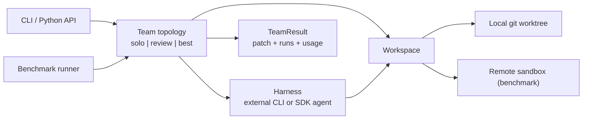

# Roadmap

## Thesis

Dozens of tools run several coding agents in parallel; none of them tells you whether the team
beat a single agent, or what the extra agents cost. Published evidence points both ways: a
coordinator plus a reviewer has gained 4–8 points over solo agents on SWE-bench, while loosely
coupled teams lost 2–15 points in a 260-configuration study. This project is a headless runner
for teams of coding agents that ships with the measurement: every team topology is benchmarked
against solo agents on fresh, uncontaminated tasks, with resolve rate, cost and wall time.

It runs on its own or inside terminal/desktop orchestrators; it does not compete with them on UI.

## Architecture



Contracts live in [`agent/teams/types.py`](../agent/teams/types.py). Harnesses and teams reach the
repository only through `Workspace.exec`, so the same team code runs locally and in benchmark
sandboxes. Teams reuse the patterns in `agent/workflows` (`RefineLoop`, `BestOfN`).

### Team specs

Teams are selected with a compact spec string; the canonical form is the team's `name`.

```text
solo:worker=H
review:coder=H,reviewer=H[,rounds=N]          # rounds defaults to 3
best:workers=H+H[+H...][,judge=H]             # judge defaults to the first worker's harness
plan:planner=H,workers=H[+H...][,integrator=H][,max_tasks=N]   # next stage, see below
H := harness[@model]                          # claude, codex@gpt-5-codex, sdk@litellm/<provider>/<model>
                                              # check: the --check command as reviewer or judge
```

## Milestones

1. **Pivot** (done) — contracts; non-coding workflows and `ml/` removed (kept in history at the
   `pre-pivot` tag).
2. **Team runner** (done) — harness adapters for external coding CLIs and a built-in any-model SDK
   agent; local worktree workspaces; `solo`, `review` and `best` teams; CLI; run records with cost.
3. **Benchmark** (built; first live run pending) — fresh-task dataset filtered by creation date;
   remote sandboxes; hidden-test evaluation; report with resolve rate, cost, wall time and
   confidence intervals.
4. **Pilot results** — 50 fresh tasks × solo and team configurations; publish the table and raw
   trajectories.
5. **Launch** — README led by the results, terminal demo, launch posts.
6. **Growth loop** — monthly refresh on newly created tasks, more harnesses, community-submitted
   team topologies.

## Current stage: teams that finish real work (done)

While the pilot (milestone 4) waits on Modal and API credentials, the runner gained end-to-end
work features, all merged and smoke-tested with real CLIs:

1. **Objective checks** — `--check CMD` runs a command (tests, build, lint) against the final
   patch in a fork and records pass/fail. `check` can be the reviewer (a test-driven loop with no
   LLM reviewer) or the judge; with an LLM judge, candidates that fail the check rank below those
   that pass.
2. **`plan` topology** — a planner splits the task into independent subtasks, workers solve them
   in parallel forks, an integrator merges the patches and resolves conflicts, and the check
   verifies the result. This is the coordinator pattern the published gains come from.
3. **Use from inside your agent** — a Claude Code plugin and a Codex plugin, installable from this
   repository, that let a running agent hand a task to a team and review the patch.
4. **Issue to pull request** — `--issue N|URL` takes the task from a GitHub issue; `--pr` commits the
   result to a new branch and opens a draft pull request with the run summary.
