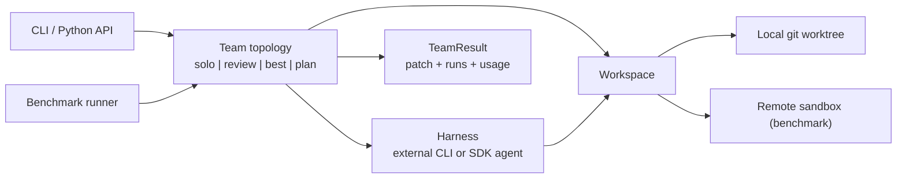

# Roadmap

## Thesis

Dozens of tools run several coding agents in parallel; none of them tells you whether the team
beat a single agent, or what the extra agents cost. Published evidence points both ways: a
coordinator-plus-reviewer team (Agyn, arXiv 2602.01465) reached 72.2% on SWE-bench Verified, +7.2
over mini-SWE-agent but only +0.4 over the strongest single-agent baseline; a decentralized patch
editor plus validator (icat-agent, arXiv 2606.25514) gained +3.6 / +8.4 over mini-SWE-agent; and
loosely coupled teams lost 2–15 points in a 260-configuration study. Numbers and caveats:
[agent-company-survey.md](agent-company-survey.md). This project is a headless runner
for teams of coding agents that ships with the measurement: every team topology is benchmarked
against solo agents on fresh, uncontaminated tasks, with resolve rate, cost and wall time.

It runs on its own or inside terminal/desktop orchestrators; it does not compete with them on UI.

## Architecture



Contracts live in [`agent/teams/types.py`](../agent/teams/types.py). Harnesses and teams reach the
repository only through `Workspace.exec`, so the same team code runs locally and in benchmark
sandboxes. Teams reuse the patterns in `agent/workflows` (`RefineLoop`, `BestOfN`).

### Team specs

Teams are selected with a compact spec string; the canonical form is the team's `name`.

```text
solo:worker=H
review:coder=H,reviewer=H[,rounds=N]          # rounds defaults to 3
best:workers=H+H[+H...][,judge=H]             # judge defaults to the first worker's harness
plan:planner=H,workers=H[+H...][,integrator=H][,max_tasks=N][,replans=N][,reviewer=H][,rounds=N]
                                              # integrator defaults to the first worker's harness; max_tasks to 4;
                                              # replans to 1 (0 = never); rounds (default 3) needs reviewer
H := harness[@model]                          # claude, codex@gpt-5-codex, sdk@litellm/<provider>/<model>
                                              # check: the --check command as reviewer or judge
```

## Milestones

1. **Pivot** (done) — contracts; non-coding workflows and `ml/` removed (kept in history at the
   `pre-pivot` tag).
2. **Team runner** (done) — harness adapters for external coding CLIs and a built-in any-model SDK
   agent; local worktree workspaces; `solo`, `review` and `best` teams; CLI; run records with cost.
3. **Benchmark** (done; Modal unverified) — fresh-task dataset filtered by creation date;
   remote Modal sandboxes or a local Docker daemon (`--backend docker`); hidden-test evaluation;
   report with resolve rate, cost, wall time and confidence intervals. First live run on
   2026-10-28: a Claude Code team solved and was graded on local Docker (Apple silicon, Claude
   subscription), details in [the benchmark README](../agent/bench/README.md#limitations).
4. **Pilot results** — 50 fresh tasks × solo and team configurations; publish the table and raw
   trajectories.
5. **Launch** — README led by the results, terminal demo, launch posts.
6. **Growth loop** — monthly refresh on newly created tasks, more harnesses, community-submitted
   team topologies.

## Past stage: teams that finish real work (done)

While the pilot (milestone 4) waits on API credentials (Modal is now optional), the runner gained
end-to-end work features, all merged and smoke-tested with real CLIs:

1. **Objective checks** — `--check CMD` runs a command (tests, build, lint) against the final
   patch in a fork and records pass/fail. `check` can be the reviewer (a test-driven loop with no
   LLM reviewer) or the judge; with an LLM judge, candidates that fail the check rank below those
   that pass.
2. **`plan` topology** — a planner splits the task into independent subtasks, workers solve them
   in parallel forks, an integrator merges the patches and resolves conflicts, and the check
   verifies the result. This is the coordinator pattern the published gains come from.
3. **Use from inside your agent** — a Claude Code plugin and a Codex plugin, installable from this
   repository, that let a running agent hand a task to a team and review the patch.
4. **Issue to pull request** — `--issue N|URL` takes the task from a GitHub issue; `--pr` commits the
   result to a new branch and opens a draft pull request with the run summary.

## Current stage: agent-company governance (done)

[agent-company-survey.md](agent-company-survey.md) compares the most-starred multi-agent
"company" projects with this runner and lists three gaps. Each is closed in code, tested offline and
smoke-tested with real CLIs.

1. **Board: run budget hard stop** — `--max-cost USD [--allow-unpriced]`. Every harness except
   `check` is wrapped in a shared budget: no new agent run starts once the limit is spent, and a
   warning is printed at 80%, as in Paperclip and MetaGPT. In-flight runs finish, so spend can
   overshoot by their cost; an unpriced run blocks further runs unless `--allow-unpriced`, and the
   CLI rejects unpriced harnesses up front. The record carries the spend and refused runs.
2. **Executive: replan failed subtasks** — `plan` `replans=N` (default 1). Subtasks whose worker
   failed or changed nothing go back to the planner, which sees the merged state and returns new
   subtasks for the rest; rotated workers solve them. This is the Magentic-One stall/replan and
   CAMEL failure-policy pattern. Conflicts still go to the integrator.
3. **Team lead: review each subtask** — `plan` `reviewer=H[,rounds=N]`. Every subtask is a
   coder ⇄ reviewer loop in its own worktree and its best patch is merged. CAID reports a manager
   reviewing every round at 60.2% against 55.1% when engineers verified their own work.
