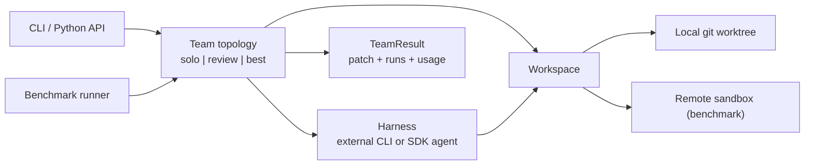

# Roadmap

## Thesis

Dozens of tools run several coding agents in parallel; none of them tells you whether the team
beat a single agent, or what the extra agents cost. Published evidence points both ways: a
coordinator plus a reviewer has gained 4–8 points over solo agents on SWE-bench, while loosely
coupled teams lost 2–15 points in a 260-configuration study. This project is a headless runner
for teams of coding agents that ships with the measurement: every team topology is benchmarked
against solo agents on fresh, uncontaminated tasks, with resolve rate, cost and wall time.

It runs on its own or inside terminal/desktop orchestrators; it does not compete with them on UI.

## Architecture



Contracts live in [`agent/teams/types.py`](../agent/teams/types.py). Harnesses and teams reach the
repository only through `Workspace.exec`, so the same team code runs locally and in benchmark
sandboxes. Teams reuse the patterns in `agent/workflows` (`RefineLoop`, `BestOfN`).

### Team specs

Teams are selected with a compact spec string; the canonical form is the team's `name`.

```text
solo:worker=H
review:coder=H,reviewer=H[,rounds=N]          # rounds defaults to 3
best:workers=H+H[+H...][,judge=H]             # judge defaults to the first worker's harness
H := harness[@model]                          # claude, codex@gpt-5-codex, sdk@litellm/<provider>/<model>
```

## Milestones

1. **Pivot** — contracts; non-coding workflows and `ml/` moved to an archived legacy repository.
2. **Team runner** — harness adapters for external coding CLIs and a built-in any-model SDK agent;
   local worktree workspaces; `solo`, `review` and `best` teams; CLI; run records with cost.
3. **Benchmark** — fresh-task dataset filtered by creation date; remote sandboxes; hidden-test
   evaluation; report with resolve rate, cost, wall time and confidence intervals.
4. **Pilot results** — 50 fresh tasks × solo and team configurations; publish the table and raw
   trajectories.
5. **Launch** — README led by the results, terminal demo, launch posts.
6. **Growth loop** — monthly refresh on newly created tasks, more harnesses, community-submitted
   team topologies.
