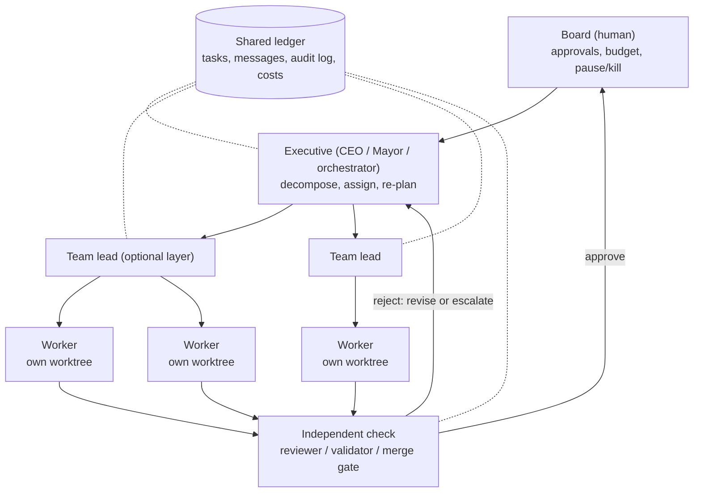

# Agent companies: a survey of the top GitHub solutions

Snapshot: 2026-10-18. This surveys how the most-starred projects organize several LLM agents like a company: who directs whom, how agents collaborate, how governance works, and whether anyone has measured a gain over a single agent.

**Method.**
- Repositories were found with `gh search repos` across 15 queries sorted by stars, plus well-known frameworks. Star counts come from the GitHub API.
- Claims come from each project's README, docs, source code, and arXiv papers. They are tagged:
  - **[code]**: read in the source.
  - **[docs]**: read in official or in-repo documentation.
  - **[README]**: claimed in the README and not verified.
- None of the systems was run.

## Landscape

### Company control planes (external coding CLIs act as employees)

| Solution | ★ | Hierarchy | Collaboration | Strongest governance mechanism | Published evidence |
|---|---|---|---|---|---|
| [paperclipai/paperclip](https://github.com/paperclipai/paperclip) | 104k | Human Board → CEO agent → managers → workers. Uses `agents.reportsTo` [code] | Tasks and comments only. Each task has one assignee, claimed with an atomic checkout. Agents wake on heartbeats [docs] | Budgets per company, per agent and per project. Warns at 80% and hard-stops at 100%, which opens a `budget_override_required` board approval. Unpriced usage blocks new work by default [code]. Board approves hires and CEO strategy [code schema, docs] | None |
| [HarnessMD/munder-difflin](https://github.com/HarnessMD/munder-difflin) | 8.9k | Human → "god" agent → workers | File "hive": each agent writes to its outbox, a router delivers to inboxes, and one process does every git commit. Message hop counts are capped [docs] | Circuit breaker steps healthy → steering → constrained → stopped. It trips on repeated tool calls, error storms, token velocity, or a cost cap. The final kill step is off by default [code] | "37% fewer tokens" in a replay (self-reported) |
| [dataelement/Clawith](https://github.com/dataelement/Clawith) | 4.2k | Peer-to-peer. Only human admins create relationships between agents [docs] | Async agent-to-agent messages, triggers, a shared feed | Autonomy level per action: L1 runs, L2 runs and notifies, L3 blocks for approval and then resumes the same run. Every check is audit-logged [code] | None |
| [TinyAGI/tinyagi](https://github.com/TinyAGI/tinyagi) | 3.6k | Flat. A team leader receives `@team` messages first | `[@teammate: msg]` tags go into a SQLite queue | None. Agents run with permission and sandbox bypass flags [docs] | None |

### Company-simulation frameworks

| Solution | ★ | Hierarchy | Collaboration | Strongest governance mechanism | Published evidence |
|---|---|---|---|---|---|
| [FoundationAgents/MetaGPT](https://github.com/FoundationAgents/MetaGPT) | 71k | Product manager → architect → project manager → engineer → QA, following an SOP (paper). Current code routes work through a `TeamLeader` [code] | Shared message pool with subscriptions. Roles hand off documents, not chat. Sequential | `Team.invest($)` raises `NoMoneyException` when the cap is reached. Round cap [code] | Author-run results: HumanEval 85.9%, MBPP 87.7% (GPT-4) |
| [OpenBMB/ChatDev](https://github.com/OpenBMB/ChatDev) | 35k | Version 1.0 pairs an instructor with an assistant (CEO→CTO, CTO→programmer, reviewer→programmer). Version 2.0 is a graph the user draws | 1.0 is a chain of phases, each a pair chat of at most 10 turns. 2.0 is a YAML DAG with parallel map | Loop-cap nodes. A `human` node in 2.0 offers ACCEPT/REVISE [docs]. No budget | Author-run quality 0.3953 vs MetaGPT 0.1523. This contradicts the MetaGPT paper |
| [msitarzewski/agency-agents](https://github.com/msitarzewski/agency-agents) | 161k | Catalog of about 230 role prompts in divisions. No runtime | Relies on the host tool's subagents, with handoff templates | Prompt-only: 3 retries then escalate; a "Reality Checker" that defaults to fail | Figures in the README cite no source |
| [TauricResearch/TradingAgents](https://github.com/TauricResearch/TradingAgents) | 112k | Analysts in parallel → bull/bear debate → research manager → trader → risk debate → portfolio manager [code] | Structured reports in shared graph state. Debate rounds are capped | Portfolio manager issues the final typed decision. The code has no reject loop back to the trader and no human gate | Backtests only against rule-based baselines. No single-LLM baseline |

### Coding-team orchestrators

| Solution | ★ | Hierarchy | Collaboration | Strongest governance mechanism | Published evidence |
|---|---|---|---|---|---|
| [gastownhall/gastown](https://github.com/gastownhall/gastown) | 18k | Human overseer → Mayor → Deacon / Witness / Refinery → worker "polecats" [docs] | Beads ledger plus `gt mail`. One git worktree per worker. Parallel | Refinery merge queue runs test and lint gates. Witness respawns stuck workers. Escalations are tagged MEDIUM, HIGH or CRITICAL; HIGH and CRITICAL also notify the human. A work item is circuit-broken after 3 failed dispatches [docs] | None |
| [Yeachan-Heo/oh-my-claudecode](https://github.com/Yeachan-Heo/oh-my-claudecode) | 40k | Lead → 19 specialist agents | Stages plan → prd → exec → verify → fix. Execution is parallel; stages hand off through files | The verifier always runs. Review depth scales with risk. `max_fix_loops` = 3, then the run ends as failed [docs] | A 5-instance smoke run only |
| [OrchestratorInc/agent-orchestrator](https://github.com/OrchestratorInc/agent-orchestrator) | 13k | Orchestrator agent → workers (one task, one worktree each) plus reviewer agents | A daemon sends PR, CI and review facts back to the worker that owns them | The human merges. A blocked session is never auto-answered [docs] | None |
| [ruvnet/ruflo](https://github.com/ruvnet/ruflo) (formerly claude-flow) | 76k | Claims "queens" over workers and 5 consensus algorithms [README] | n/a | A third-party audit (issue #1514) reports most tools are stubs and consensus runs in one process | Self-reported only |
| [Claude Code agent teams](https://code.claude.com/docs/en/agent-teams) | first-party | Lead → teammates. Teams cannot nest | Shared task list with file-locked claiming, plus a mailbox per agent | Teammates inherit the lead's permissions. Hooks can block task create, task complete and idle. No budget cap and no file isolation [docs] | None. The docs say it costs "significantly more" tokens |

### Framework primitives for hierarchy

| Framework | ★ | Primitive |
|---|---|---|
| [crewAI](https://docs.crewai.com/en/learn/hierarchical-process) | 60k | `Process.hierarchical`: a manager agent delegates and validates. Guardrails retry 3 times. `human_input`. Token use is reported but not capped |
| [AutoGen Magentic-One](https://microsoft.github.io/autogen/stable/user-guide/agentchat-user-guide/magentic-one.html) / [MS Agent Framework](https://learn.microsoft.com/en-us/agent-framework/workflows/orchestrations/magentic) | 61k / 14k | Orchestrator keeps a task ledger and a progress ledger. A stall counter above 3 triggers a reset and replan [code]. Plan sign-off is opt-in in Python and on by default in .NET. Tool approval |
| [LangGraph](https://docs.langchain.com/oss/python/langchain/multi-agent) | 43k | Supervisors that can nest. `interrupt()` pauses at a checkpoint for a human. `recursion_limit` hard-caps steps |
| [OpenAI Agents SDK](https://openai.github.io/openai-agents-python/multi_agent/) | 30k | Manager pattern (agents as tools, so the manager keeps ownership) vs handoff (the receiver takes ownership). Guardrail tripwires, `needs_approval`, tracing on by default |
| [CAMEL Workforce](https://docs.camel-ai.org/key_modules/workforce) | 18k | Coordinator + task planner + workers. `FailureHandlingConfig`: retry, replan, decompose, create_worker, reassign; `max_retries` = 3 [code] |
| [agency-swarm](https://agency-swarm.ai/core-framework/agencies/communication-flows) | 4.6k | `communication_flows` lists the (sender, receiver) pairs that are allowed to talk; no other paths exist |

### Explicit governance models

| Solution | ★ | Model |
|---|---|---|
| [cft0808/edict](https://github.com/cft0808/edict) | 17k | Modeled on the Tang dynasty "three departments and six ministries": one office drafts, a second approves or vetoes, a third dispatches to six ministries. A state-transition table plus a per-role command allowlist; denied attempts are written to `audit_log.json` [code]. The veto loop is capped at 3 rounds, then forced to pass, but only in the prompt. No budget |
| [agentscope-ai/AgentTeams](https://github.com/agentscope-ai/AgentTeams) | 5.8k | Admin → manager → team leader → workers, as Kubernetes CRDs. Chat runs in Matrix rooms, and the manager is excluded from team rooms. Tool approval per worker: STRICT, SMART, AUTO or OFF. Pause, resume and replan APIs. Append-only audit JSONL [code] |

Not surveyed:
- openclaw/openclaw (392k): a single personal-agent runtime that edict and AgentTeams build on.
- OpenHands (91k): a single-agent scaffold.
- bytedance/deer-flow (84k): not covered.

## What the top solutions converge on

| Layer | Job | Names in the wild |
|---|---|---|
| Board | Approves hires, strategy, budget overrides. Can pause or kill | Paperclip Board, Gas Town Overseer, AgentTeams Admin |
| Executive | Decomposes, assigns, replans when stuck | Paperclip CEO, Gas Town Mayor, Magentic-One Orchestrator, Claude Code team lead |
| Team lead | Middle layer between executive and workers | AgentTeams Team Leader, Paperclip managers (`reportsTo`), nested LangGraph supervisors, nested CAMEL workforces |
| Worker | One task in an isolated workspace | Gas Town polecats, agent-orchestrator workers, Claude Code teammates |
| Independent check | Approves or rejects; must not be the author | edict's approval office, Gas Town Refinery, oh-my-claudecode verifier, Paperclip review stage |
| Ledger | Durable record of tasks, messages, costs and decisions | Paperclip activity log, Gas Town Beads, edict `audit_log.json`, Magentic-One task and progress ledgers |

## Governance mechanisms and who enforces them

| Mechanism | Implemented in | Prompt-only or claimed in | Typical setting |
|---|---|---|---|
| Hard dollar budget | Paperclip [code], MetaGPT [code], munder-difflin [code, kill off by default] | — | Warn at 80%, stop at 100% (Paperclip) |
| Retry / round cap | CAMEL, Magentic-One [code]; crewAI, oh-my-claudecode, Gas Town, ChatDev [docs] | agency-agents, edict | **3** almost everywhere |
| Human approval gate | Paperclip approvals, Clawith L3 [code]; MAF plan sign-off, LangGraph `interrupt`, OpenAI `needs_approval`, ChatDev 2.0 `human` node [docs] | edict's human-approval step (design doc only) | Opt-in in most frameworks |
| Independent veto | edict state machine [code; caller identity is not checked]; Paperclip review stage (secondary sources; open self-approval issues #15127, #15265) | agency-agents | — |
| Who may talk to whom | agency-swarm flows, edict `allowAgents`, AgentTeams rooms, Clawith relationships | Paperclip cross-team rule | — |
| Escalation ladder | Magentic stall → replan, CAMEL failure strategies [code]; Gas Town severities [docs] | agency-agents, edict | Paperclip: 3 agent-only review rounds, then a human |
| Audit log | edict, AgentTeams, Paperclip [code]; munder-difflin `log.jsonl` + git | — | Append-only JSONL |
| Worktree per worker | Gas Town, agent-orchestrator [docs]; CAID (paper) | — | Claude Code teams: none |

## Evidence: does a company beat one agent?

| Source | Setup | Result | Caveat |
|---|---|---|---|
| [Kim et al., arXiv 2512.08296](https://arxiv.org/abs/2512.08296) | 260 configurations, 6 benchmarks, same token budget for every setup | Hierarchical topologies do worse on coding tasks than the single agent (SWE-bench Verified −2.1% to −14.9%; Terminal-Bench centralized −19.2%). Large gains on parallel tasks (Finance +80.8%). Above about 45% single-agent accuracy, adding agents hurts | SWE-bench and Terminal-Bench used 20-instance subsets |
| [MAST, arXiv 2503.13657](https://arxiv.org/abs/2503.13657) | 1,642 failed traces from 7 frameworks | 23.5% of failures are verification failures. In ChatDev, making the CEO the final decider gave +9.4%; adding an objective-verification step gave +15.6% | Failures labeled by an LLM judge; no confidence intervals |
| [CAID, arXiv 2603.21489](https://arxiv.org/abs/2603.21489) | Manager + engineers in separate worktrees; merges only commits that pass tests | +6 to +15 points on long-horizon builds at 2–4× the cost. A shared workspace scored below a single agent. A manager reviewing every round scored 60.2% vs 55.1% when engineers verified their own work | Builds from scratch, not issue fixes |
| [Agyn, arXiv 2602.01465](https://arxiv.org/abs/2602.01465) | Manager + researcher + engineer + reviewer; the reviewer must approve the PR | 72.2% on SWE-bench Verified: +7.2 over mini-SWE-agent, +0.4 over the strongest single-agent baseline | Uncontrolled: different models per role, failed runs resumed |
| [icat-agent, arXiv 2606.25514](https://arxiv.org/abs/2606.25514) | **Decentralized, no coordinator**: patch editor and validator with isolated context | +3.6 / +8.4 on SWE-bench Verified over mini-SWE-agent | No ablation of the reviewer |
| [TheAgentCompany, arXiv 2412.14161](https://arxiv.org/abs/2412.14161) | Simulated software company, 175 tasks, single agent as the worker | Best single agent 30.3%. One multi-agent system (OWL) scored 4.0% vs 8.6% for the single agent on the same model | Not a controlled team comparison |

Takeaways:
- On coding tasks, a hierarchy alone does not beat one agent.
- Gains come from two things:
  - Independent verification with isolated context (MAST, icat-agent, CAID).
  - Isolated parallel work that is merged only through a test gate (CAID).
- No source compares the same model as a single agent and as a team with the reviewer on and off, on SWE-bench-style issues.

## Mapping to this repository

| Company layer | Here today | Gap, and who implements it in code |
|---|---|---|
| Board | The user: `--permissions`, `--apply`, `--pr` (draft) | Run budget hard stop: Paperclip, MetaGPT |
| Executive | `plan` planner | Replan when a subtask fails: Magentic-One stall counter, CAMEL failure policy |
| Team lead | `review` reviewer; `best` judge | `plan` workers are single agents with no reviewer per subtask. CAID: manager review each round 60.2% vs self-verification 55.1% |
| Worker | One worktree per worker | — |
| Independent check | `--check`; reviewer and judge work in a fork | — |
| Ledger | Run record with every harness call, tokens, cost | — |

Correction: [`README.md`](../README.md) and [`ROADMAP.md`](ROADMAP.md) attribute "a central coordinator and a reviewer: 4–8 points better" to icat-agent. icat-agent has no coordinator. Agyn is the coordinator-plus-reviewer result: +7.2 points over mini-SWE-agent and +0.4 over the strongest single-agent baseline.
