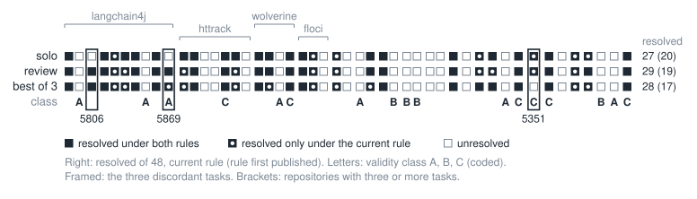
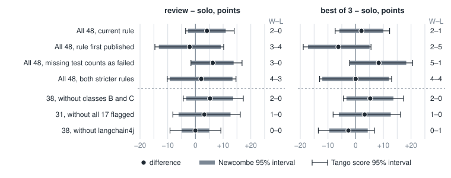
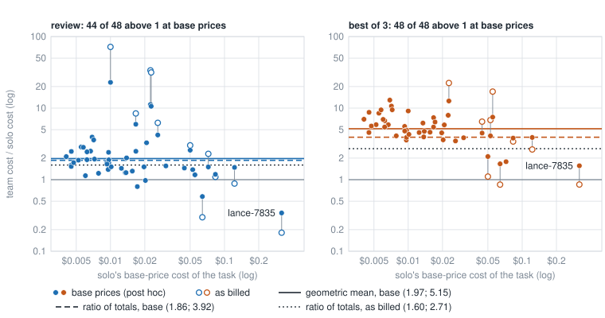
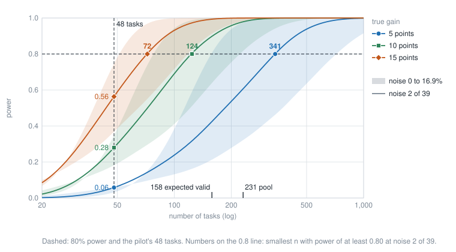
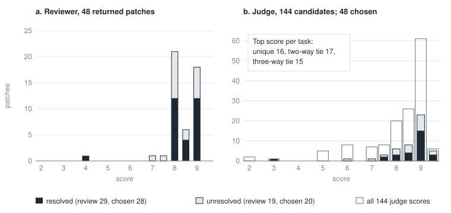

# Measuring Coding-Agent Teams Against One Agent: Lessons from a 48-Task Pilot

Bicheng Wang · [https://github.com/BichengWang/multi-agents](https://github.com/BichengWang/multi-agents) · November 2026 · [PDF](paper.pdf)

## Abstract

In a 48-task pilot on SWE-bench-Live MultiLang, one rollout per task, a single Claude Code agent (Claude Haiku 5.5) and two teams of it (a coder-reviewer loop and an LLM-judged best of 3) resolved 27, 29 and 28 tasks. The paired differences, +4.2 points (95% intervals: Newcombe −2.7 to +10.9, Tango −3.6 to +14.0; exact McNemar p = 0.50) and +2.1 (−5.9 to +10.0; −7.4 to +12.3; p = 1.00), rest on three tasks, two in one repository; the exact test needs six discordant tasks to reject at 0.05 (mid-p, five). Under the runner's superseded grading rule both were negative (−2.1, −6.3). An audit (one coding pass, then a written rule not blind to it) flags 17 tasks whose tests cannot, or need not, respond to the fix; 10 are decidable before any run. The reviewer approved 47 of 48 final patches, 19 of them unresolved; the judge's top score tied on 32 of 48 tasks. At base prices (post hoc) the teams cost 1.9 (95% bootstrap 1.2 to 3.1) and 3.9 (2.9 to 5.4) times the single agent, more on 44 and 48 of 48 tasks; as billed, 1.6 and 2.7, because one solo run is 47.1% of solo's billed cost. We size each hazard, give its check and plan a decisive comparison.

## 1. Introduction

Vendor guidance recommends "finding the simplest solution possible, and only increasing complexity when needed" [1]. Claude Code's documentation says agent teams "use significantly more tokens than a single session" but reports no measured outcome against a single agent [2]; the teams here are runner-built topologies, not that feature. Independent [3], concurrent [4] and prior [5] studies have measured teams against one agent, so the question is not new.

!!! note "How to read this paper"

    This is a pilot: 48 tasks, one model, one rollout per task and arm, nothing pre-specified. Post hoc, decided after the results were known: the current patch-application rule; the Newcombe interval and every other interval, test, power or planning number beyond the runner's Wilson intervals and exact McNemar p-values; the base-price, paired-cost, sandbox-hour and verifier statistics; the validity audit, every task subset and every statement of what the data exclude. Decided during the run: the rule under which 106 first-day records were relabelled as infrastructure errors and re-run, and a 107th relabelled outside it (Appendix H). Untagged numbers are *computed* by the companion script, from the published records or from dataset-row and upstream-page values that its labels file holds with source and date; *coded* marks a label from a single coding pass or a written rule; *inferred*, a conclusion; *not recorded*, what the records lack. *Arms* are solo, review and best of 3; *teams*, the latter two; a *discordant task* is one that a team resolves and solo does not, or the reverse.

Solo, review and best of 3 resolved 27, 29 and 28 of 48 tasks (Table 1). That outcome evidence is weak: both teams' wins are two tasks of one repository (without it, the differences are 0.0 and −2.6 points); review's wins are first patches approved unchanged, the only two of 39 such patches whose outcome differs from solo's (§7); and only the runner's superseded grading rule makes the 48-task differences negative. The cost direction is clear but expected by design (§5.3). The verifier evidence is descriptive.

So the pilot could not decide whether either team beats one agent, but did measure what both cost. At the few-point gains prior work predicts, a decisive comparison (80% power for a two-sided paired test at 0.05) needs more valid date-filtered tasks than the pilot's pool could supply (inferred). The paper contributes:

- a paired, cost-itemised comparison that a standard-library script recomputes from the published records and a labels file;
- sizes for three measurement hazards (grading rule, task validity, cost definition), each with a check;
- the verifiers' verdicts against hidden-test outcomes, with a base rate;
- planning numbers for a decisive comparison.

None of these hazards, nor the verdict tabulation [5], is new in kind; what is added is their sizes in one team-versus-solo comparison and a check for each.

## 2. The effect to expect

On repository-level tasks, prior work puts the gain of both designs mostly at a few points (Table G1). Concurrent work finds a coder plus reviewer at −2.92 to +3.83 points and a test-ranked best of four at −3.29 to +5.21 against one run, over 13 models on 113 tasks (our differences of its Table 4); for the four main models none exceeds the study's approximate 95% half-widths, 4.46 to 6.66 points [4]. Same-model review adds +2.8 and +0.7 points on SWE-bench Verified, with no significance test found (inferred) [5]. On single-file problems Claude reviewing its own solutions matched its pass rate at 1.72 times the cost (our ratio), while the weaker Codex gained 12.9 points [6]. Choosing among three candidates by an LLM's score for each resolves 62.33% of SWE-bench Verified, against 61.33% at random and 70.00% for an oracle [7]; direct integer scores tie in text evaluation [8]. Our reading (inferred): a same-model reviewer adds a few points at best, and best of N 1 to 3 points at three times the generation cost or more. On SWE-bench Verified, single-run pass@1 estimates vary by 2.2 to 6.0 points with the run selected [9], so gains this small depend on measurement design. Other same-model designs report larger gains [10, 11, 12]. The pilot combines conditions these studies do not: issues whose fixing pull request postdates the model's training cutoff, one unmodified commercial CLI in every role, an LLM judge, exact paired tests and itemised dollars.

## 3. The pilot

The runner itemises every agent call's tokens, cost and seconds; Appendix A gives the configuration and prompts.

**Arms.** Solo is one headless Claude Code session with the CLI's default tools, which for a later version include built-in subagents [13]; whether any run started one is not recorded. In review, a reviewer judges each coder attempt once, in a fresh sandbox and session, returning `{score, passed, feedback}`; the loop stops when `passed` is true or after three attempts, and the team returns the highest-scoring attempt, the earliest on a tie. In best of 3, a judge scores each of three candidates alone (0 to 10) in a fresh sandbox; the earliest top-scoring candidate wins, and the judge's `passed` flag is ignored.

Operative prompt lines: "Run the project's tests where they exist to verify your change." (workers); "run the project's tests or write throwaway checks where useful. Do NOT modify, create or delete any file in the repository" (verifiers); "Set passed to true only if the change fully solves the task and needs no revision." (verdict). The verifier sees the issue and the patch (cut at 40,000 characters; 3 of 48 final review patches are longer), without the author's build output.

Claude Code ran unmodified (no system prompt added, no tool removed, no effort flag passed); the effort used, the tool list and the CLI version (pinned at 2.1.310) were not recorded. Solo, a review coder and each best-of-3 worker get the same first prompt, command line and model, so their patches on one task differ by rollout variation (inferred).

**Tasks.** SWE-bench-Live MultiLang [14, 15] (revision `3638632e8153`) has 231 tasks whose fixing pull request was opened on or after 2026-07-01 (`created_at`, checked on 12 tasks), after the model's training cutoff, which the vendor gives only as June 2026 [16]. But 7 of the 48 linked issues predate 2026-07-01, and SWE-rebench's rule [17] would flag all 48 as older than the model (2026-10-07 [18]): the tasks are *date-filtered*. The task set, fixed before any team ran, is the 48 of 70 drawn tasks (seed 7) whose reference patch passed one validation grading, from 23 repositories.

**Run and grading.** Each task-arm pair had a remote sandbox with an open network, a 3,600 s solve limit and every git ref, remote, reflog and unreferenced object removed, so git history held the base commit's ancestors but not the fix. The API key hit its usage limit in the first of two invocations (2026-10-29 and 2026-10-31 UTC); the pairs it stopped were re-run after results for 11 tasks were published. The grader applies the hidden test patch, then the submission; a pair is resolved if every required (FAIL_TO_PASS) test passes and no regression (PASS_TO_PASS) test fails [19], under a patch-application rule (§5.1).

**Statistics.** Rates carry Wilson 95% intervals [20]; paired differences, the exact conditional McNemar test [21, 22] and Newcombe's method 10 [23], with Tango's score interval [24] beside it, since with few discordant tasks Newcombe's upper limit falls below the true gain too often (Appendix E). Nothing is corrected for multiplicity. *As billed* is Claude Code's own `total_cost_usd` at list prices, not an invoice; *at base prices* charges every run $0.125 (the cache-write rate), $0.01 and $0.50 per million uncached input, cache-read and output tokens [25]. Primary, designated after the results: the paired difference under upstream's test-only criterion (Appendix B), which the current rule reproduces on all 144 pairs. Secondary: model cost. The rest is exploratory.

## 4. The headline and what it rests on

The arms agree on all but three tasks (Figure 1): all arms resolve 26, none 19.

**Table 1.** Outcomes and model cost, one rollout per pair: rows 1–4 under the current rule (post hoc), row 5 under the rule first published; cost ratios of unrounded totals with 95% task-bootstrap intervals.

| Quantity | solo | review | best of 3 |
|---|---|---|---|
| 1 Resolved of 48 (Wilson 95%) | 27, 56.3% (42.3–69.3) | 29, 60.4% (46.3–73.0) | 28, 58.3% (44.3–71.2) |
| 2 Wins–losses against solo; difference, points | | 2–0; +4.2 | 2–1; +2.1 |
| 3 95% interval of the difference: Newcombe; Tango score | | −2.7 to +10.9; −3.6 to +14.0 | −5.9 to +10.0; −7.4 to +12.3 |
| 4 Exact McNemar p (mid-p) | | 0.50 (0.25) | 1.00 (0.625) |
| 5 Rule first published: resolved; wins–losses (difference) | 20 | 19; 3–4 (−2.1) | 17; 2–5 (−6.3) |
| 6 Model cost at base prices, post hoc: total; ratio to solo | $1.31 | $2.45; 1.86 (1.2–3.1) | $5.16; 3.92 (2.9–5.4) |
| 7 Model cost as billed: total; ratio to solo | $2.95 | $4.73; 1.60 (0.7–4.9) | $7.99; 2.71 (1.6–6.0) |

Both teams win `langchain4j__langchain4j-5806`, where solo's patch fails an existing regression test, and `langchain4j__langchain4j-5869`, where the hidden test calls `resolveEndpoint`, a name in the reference patch but not the issue; solo named its helper otherwise (coded), so the verdict records a naming coincidence, not a better fix (inferred). Best of 3 loses `nunit__nunit-5351` (class C, §5.2), where its chosen candidate edited an existing test's expected message in a hidden-test file and that test fails (coded). On none of the three did a verifier stop a failing patch that the team replaced with a resolving one (inferred): review's wins are approved first patches, and best of 3 took `langchain4j-5806` by the tie-break among three scores of 9.

<figure markdown="1"><figcaption><strong>Figure 1.</strong> Every graded outcome, one rollout per cell: dotted cells are resolved only under the current rule (7, 10 and 11 by arm), letters mark the 17 flagged tasks (coded), and framed columns are the three discordant tasks.</figcaption></figure>

## 5. What was measured

Three measurement choices set what these numbers mean.

### 5.1 A non-upstream grading rule set the sign

The patch-application rule has three versions. Upstream, whether the patch applies does not enter the verdict. Under the rule first published (committed 2026-10-25, before the run) the submission had to apply in full: the runner's own departure from upstream, now superseded. Since 2026-11-02 a rejected hunk is tolerated when every rejected file is one the hidden test patch changes: that patch is applied first, and agents often add tests to its files. The re-grade changed 28 of 144 verdicts (7, 10 and 11 by arm), all to resolved: review went from 3 wins and 4 losses (−2.1 points; Newcombe 95% −13.2 to +9.2) to 2–0, best of 3 from 2–5 (−6.3; −17.2 to +5.0) to 2–1 (Figure 2, Appendix B). That is why the sign changed; whether teams trigger the first rule more often than one agent is not established. Counting a missing regression test as failed gives +6.3 and +8.3 points, but three of the four tasks that move are class C. A residual hazard remains, and applies to the upstream procedure too (inferred): agent hunks applied on top of hidden-test files decide 4 of the 60 unresolved pairs (coded, single pass). Precedent: UTBoost's repaired log parser found annotation errors in 54.6% of SWE-Bench Lite and 54.2% of Verified instances [26].

**Check.** Table 4, *Grading rule*.

<figure markdown="1"><figcaption><strong>Figure 2.</strong> Team minus solo, in points, under four grading rules on all 48 tasks (rows 1 to 4) and three subsets under the current rule (rows 5 to 7); Newcombe (thick) and Tango score (thin) 95% intervals all contain zero. Only row 2's rule predates the results; row 6 conditions on the outcome (class A uses failure logs); row 7 drops the repository of both teams' wins. Rows are not independent.</figcaption></figure>

### 5.2 Tests that cannot, or need not, respond to the fix

A written matching rule over the dataset rows and stored grading logs flags 17 of the 48 tasks: 7 whose hidden tests use a symbol the reference patch introduces or makes accessible and the issue never names (class A); 4 with a required test defined inside the reference patch (class B); and 6 with no required test anchored in either patch (class C). A single coding pass assigned the classes; the rule, applied by script and not blind to that pass, re-derived all 48 (Appendix C). Classes B and C (10 tasks) can be decided from dataset rows alone, before any run; class A needs a failure log. In the 231-task pool the rule and a further check keep 15 class B rows (6.5%; coded) and 23 class C rows (10.0%; coded, single pass), against 8.3% and 12.5% in the pilot. Removing flagged tasks leaves the sign unchanged: without classes B and C (38 tasks) both differences are +5.3 points, and without all 17, +3.2; the 48-task rates stay primary, since removing class A conditions on failure. The rule's recall is unknown. Precedents: tests that reject correct fixes, including class A's kind, in at least 59.4% of an audited SWE-bench Verified subset [27], about 30% of SWE-bench Pro tasks estimated broken [28], and the terms *task validity* and *outcome validity* [29].

**Check.** Table 4, *Task validity*.

### 5.3 The cost ratio depends on its definition

The published multiples, 1.6 and 2.7, are ratios of totals as billed, and one run dominates them: solo on `lance-format__lance-7835` ($1.39; 20.1 million input tokens; billed at 4.37 times its base-price cost; unresolved) is 47.1% of solo's billed total. The vendor charges five times the base price for a request whose prompt exceeds 100,000 tokens [25]; the excess over base prices is 43.1% of all billed cost (which requests were long is inferred). At base prices the ratios of totals are 1.9 (95% task bootstrap 1.2 to 3.1) and 3.9 (2.9 to 5.4), and the teams cost more on 44 and 48 of 48 tasks (exact sign test p < 0.001; Table D1). Geometric means of per-task ratios, 2.0 and 5.2, describe the typical task; ratios of totals, the budget. Among the five rollouts per task that share the solo configuration, the largest of ten pairwise ratios of billed totals is 2.2 (1.4 at base prices), so the billed 1.6 lies within rollout variation. Solo always started first; if later rollouts read its cache entries (inferred), the base-price multiples are understated by up to 9.5%. "Useful agent evaluations must control for cost" [30]; the pilot has no cost-matched simple baseline.

**Check.** Table 4, *Cost definition*.

## 6. What the reviewer and the judge did

The only findings about the teams themselves are descriptive counts against the same grader (Table 2, Appendix F). The reviewer approved the first patch on 39 of 48 tasks and the final patch on 47, of which 19 did not resolve; approving everything would have been right on 29 tasks, the reviewer on 28. The judge's top score tied on 32 of 48 tasks, and candidate 1 was chosen on 29, 25 of them by the tie-break. The verifier lacked the author's build output and was told not to write files, which at least 11 of 205 verdicts cite for not building or testing (keyword count).

**Table 2.** Verifier verdicts against hidden-test outcomes, with the share resolved as the precision of passing everything; AUC of the reviewer's score of the returned attempt (row 2: the first) and of the judge's score of the chosen candidate (task-bootstrap 95%).

| Verdict, 48 tasks | Resolving passed | Unresolved stopped | Precision (share resolved) | AUC of the score (95%) |
|---|---|---|---|---|
| Reviewer, final verdict | 28 of 29 | 0 of 19 | 28 of 47 (29 of 48) | 0.58 (0.42–0.73) |
| Reviewer's first verdict against final outcome | 24 of 29 | 4 of 19 | 24 of 39 (29 of 48) | 0.56 (0.39–0.72) |
| Judge's `passed` flag, chosen candidate | 27 of 28 | 4 of 20 | 27 of 43 (28 of 48) | 0.57 (0.41–0.72) |

On the 31 unflagged tasks, a set that conditions on outcomes, the final verdict stopped 0 of 9 unresolved patches and the judge's flag 3 of 9 (Table F1). Of the 19 approved unresolved patches, 6 are on class A tasks, 4 on class B and 1 a partial apply, none visible from the issue and the repository (coded, single pass); the other 8 are on tasks where a hidden test runs and fails for at least one arm.

On the 9 tasks with change requests, review and solo resolve the same 5; the later rounds cost 50.4% of review's billed model cost, and the first patches were not graded.

**Check.** Table 4, *Verifier*.

## 7. What 48 tasks could detect, and what a decisive comparison needs

The smallest outcome the exact two-sided McNemar test rejects at 0.05 is six discordant tasks, all one way (p = 0.031); under the mid-p test that [22] recommends it is five. The pilot had 2 and 3; mid-p values of 0.25 and 0.625 show that the failure to reject does not rest on the exact test's conservatism. With rollout noise of 2 of 39 under an additive model, power at 48 tasks is 0.28 for a true 10-point gain (Table 3; 0.40 under mid-p, Appendix E), and 80% power needs a gain of 20.5 points.

The noise estimate comes from the 39 tasks where the reviewer approved the first patch: there review submitted an accidental, selected second rollout of the solo configuration (inferred, §3); it disagrees with solo on 2 of 39 (5.1%; Wilson 95% 1.4% to 16.9%), review's two wins, which best of 3 also wins. The pilot cannot tell either team from a second rollout of solo (inferred), a reading that rests on selected inputs and does not separate rollout from grader noise.

**Table 3.** What 48 tasks could detect (current rule, all 48 tasks; *excluded*: rejected at one-sided 5%) and what a decisive comparison needs (exact two-sided McNemar test at 0.05; additive noise; independent tasks).

| True gain | Excluded by the pilot? | Power at 48 tasks, noise 2 of 39 | Tasks for 80% power (noise 0 / 2 of 39 / 16.9%) |
|---|---|---|---|
| 5 points | by no test (p 0.40–0.57 review; 0.23–0.31 best of 3) | 0.06 | 157 / 341 / 718 |
| 10 points | by Newcombe (undercovers) and the repository bootstrap (indicative), not by score or exact unconditional tests (p 0.089–0.129; 0.052–0.055) or, for review, the cluster-robust t (Appendix B) | 0.28 | 78 / 124 / 222 |
| 15 points | by every method (p ≤ 0.020) | 0.56 | 52 / 72 / 118 |

Both teams' wins are in one repository of the 23 (11.1 effective clusters), langchain4j: the task counts are lower bounds, and a study should be sized in repositories too (inferred). At the pilot's validation rate the pool would yield about 158 valid tasks, 48 already studied; the other 110 (92 to 126 at the rate's Wilson 95% limits) about match the 108 that a 10-point gain needs under the mid-p test; the exact test needs 124, a 5-point gain 309 and 341. At about $100 for 124 tasks and $274 for 341, both lower bounds (three arms, Appendix E), valid tasks, not money, bind (inferred). Miller recommends paired inference, clustered errors and a power analysis [31]; here the latter two are post hoc.

**Check.** Table 4, *Power and noise*.

## 8. Limitations

The pilot used one model in every role, one harness, tasks from one month and one rollout per pair. Other verifier designs did better or worse in prior work [6, 7]; this verifier's conditions (no build output, the no-write instruction, pointwise scores, the first-index tie-break, the patch author's model) have unknown effect.

Solo kept every default tool; a study that removed subagents from its single arm used a different baseline [3]. 25 of 48 tasks ship a root `CLAUDE.md` or `AGENTS.md` that the CLI loads [13], the same for every arm; 15 verdicts cite one. Validation dropped 22 of 70 sampled tasks, 10 of them Rust, so the kept set does not represent the pool; it used only reference patches, before any arm ran, so it favours no arm.

The network was open, the fixes were public three to four months before the run, and no tool calls were stored; comparing final with reference patches (median verbatim share 0.076) found no positive sign of a fetched fix and cannot exclude one. 13 of 48 reference fixes credit a Claude model in a commit trailer; each arm resolves 8 of those 13.

Also not recorded: the code commit, transcripts, round patches and unchosen candidates, so there is no oracle bound for best of 3 and no trajectory audit. Since `878a2f9`, after the pilot, the runner stores transcripts, round patches and candidates, but still no code commit or CLI version. Most safeguards predate the run (Table H1). Grader noise was not measured.

## 9. A checklist for the next comparison

What stands: at base prices the teams cost 1.9 (95% task bootstrap 1.2 to 3.1) and 3.9 (2.9 to 5.4) times the single agent, more on 44 and 48 of 48 tasks; a gain of 15 points or more is excluded at one-sided 5% on all 48 tasks under the current rule, but not by the exact unconditional test without classes B and C (p = 0.062) or under the missing-test rule (Appendix B). Whether a smaller gain exists is open; Table 4 lists the checks.

**Table 4.** Six checks, each with the pilot's number and what it needs; recommendations from one study, not tested procedures; rows 1, 2 and 5 specialise [29, 31].

| Property | In the pilot | Check | Needs; when |
|---|---|---|---|
| Grading rule | the sign changed with the rule (28 of 144 verdicts); hidden-test-file hunks decide 4 of 60 unresolved pairs (coded, single pass) | store apply logs and per-test results; count per arm the verdicts each departure from upstream changes; report every defensible rule; date rule changes | stored grading output; before reading results |
| Task validity | 17 of 48 flagged (coded), 10 decidable from dataset rows; 2 of 3 discordant tasks flagged | screen for reference-only and unanchored tests; report with and without flagged tasks, the full set primary; read every discordant task | dataset rows; before sampling |
| Cost definition | 1.86 at base prices, 1.60 as billed; one run is 47.1% of solo's billed cost | name the definition; beside a ratio of totals, print a per-task statistic, the costliest run's share and a leave-one-out range; record arm order | token counts, prices; before the run |
| Verifier | right on 28 of 48, approving everything on 29; top score tied on 32 of 48 | replay the verifier on graded patches; report the base rate and ties, not an approval rate | graded patches; before paying for a team |
| Power and noise | six discordant tasks needed by the exact test (five by mid-p), 2 and 3 seen; 2 of 39 accidental replicates disagree with solo | compute power from two baseline rollouts per task; size in tasks and repositories; fix test, rule, screen and margin in writing | an extra baseline arm; before the run |
| Records | no unchosen candidates, round patches, transcripts, commit or CLI version | store and grade every candidate and round patch; keep transcripts, commit and CLI version | storage; before the run |

The [roadmap](https://github.com/BichengWang/multi-agents/blob/3f60bba/docs/ROADMAP.md)'s next stage replaces the reviewer and the judge with the repository's visible test suite, on the same 48 tasks against the published solo baseline. Its hazards (inferred): that baseline is not concurrent; reusing studied tasks is adaptive; at 48 tasks the stage is exploratory (§7); the visible suite cannot catch a hidden test that fails to compile. It states no hypothesis, smallest effect, threshold, sample size or multiplicity plan and is not pre-registered.

## Data and code

Code and data are cited at commit `3f60bba`, not at package release 0.1.0, which predates the pilot; the repository carries an MIT licence ([LICENSE](../../LICENSE)). This paper and the files beside it ([analysis.py](analysis.py), [numbers.json](numbers.json), [labels.csv](labels.csv), [references.bib](references.bib), the figures) are in `docs/paper/` at commit `25e82c5`. The LaTeX version is built from the Markdown source, `docs/paper/index.md`, by `python3 -B docs/paper/arxiv/build.py` (added after `25e82c5`), which needs pandoc 3.14, cairosvg for the figures and pdflatex for the PDF. The data package, [results/2026-10-haiku-pilot/](../../results/2026-10-haiku-pilot/), holds `meta.json`, `results.jsonl.gz` (251 records), `artifacts.tar.gz`, `gold.jsonl` and `report.md`. `report.md` (sha256 `4cfdd329…358b`) regenerates byte for byte with the code at `3f60bba`, Python 3.10 or later and `pydantic` (with its own dependencies, the only third-party code the command imports): copy `meta.json` into an empty directory `<dir>`, unpack `results.jsonl.gz` into it as `results.jsonl`, and run `python -m agent.bench report <dir> --baseline solo:worker=claude@claude-haiku-5-5 --out <file>` from the repository root. The re-graded records replay byte for byte from the file published at commit `8d7d046` under the rule of commit `a3d53ff` (procedure in Appendix H); the replay also needs the hidden test patches of the pinned dataset rows, and its script is not in the repository. Seed 7 re-draws the sample (`python -m agent.bench tasks --since 2026-07-01 --limit 70 --seed 7`, with the package's `bench` extra; it downloads the pinned dataset). `gold.jsonl` is a summary in its own schema; to rerun the 48 tasks, pass the ids from `meta.json` with `--instance-id`. The rollouts, the exact agent, the task images (named without tag or digest; only the checked-out commit is verified) and the relabelling of the first-day records cannot be reproduced. Appendix I lists where this paper departs from the published results page ([`docs/pilot-2026-10.md`](https://github.com/BichengWang/multi-agents/blob/3f60bba/docs/pilot-2026-10.md)).

Numbers in this paper are computed by [analysis.py](analysis.py) from the published records and written to [numbers.json](numbers.json), with the figures (Appendix J), except the validity classes, the pool rates, the issue and pull-request dates, the root instruction files, the repository hooks, the commit-trailer counts, the dataset-row descriptives, the leakage proxy, the third-party submission check and the coded counts, which it reads from [labels.csv](labels.csv) with each value's source and the date it was obtained. Commit hashes, dates and times, code constants and line numbers are read from the repository at `3f60bba` and its history; the sha256 values are of the published files; numbers from cited works are the sources' own, except those marked "our", which are arithmetic on values the sources print. Dates of code and rule changes are commit dates on the main branch, in UTC (Table H1). Compute: $15.67 of model cost as billed for the 144 final pairs, plus $1.14 on four superseded records; solve sandbox-hours 3.84, 8.75 and 21.70, and grading sandbox-hours 5.12, 4.36 and 4.79 (sums of timed spans, so lower bounds: sandbox start-up and fork setup are not timed).

## Safety note

Every agent ran with permission prompts bypassed, as root (inferred), in a single-use remote sandbox with a four-hour lifetime. The agent can read its API key; the key had a spend limit, and grading sandboxes hold none. Issue text reaches the prompt verbatim, with no "data, not instructions" framing. In a `claude -p` session the CLI loads instruction files, settings and hooks from the task repository, and a repository's hook would run [13]; no task repository defines one at its base commit (public trees; the sandbox copies are inferred identical). The open network is also an exfiltration surface. Credential-shaped strings are scrubbed before anything is written to disk; 12 of 144 final records were flagged, false positives according to the published results page.

## References

1. Erik S. and Barry Zhang. Building effective agents. Anthropic Engineering blog, 2024. [https://www.anthropic.com/research/building-effective-agents](https://www.anthropic.com/research/building-effective-agents)
2. Anthropic. Orchestrate teams of Claude Code sessions. Claude Code Docs, no date, read 2026-11-21. [https://code.claude.com/docs/en/agent-teams](https://code.claude.com/docs/en/agent-teams)
3. Katrina Drozdov. Do Agent Teams Pay Off? A Case Study on Vibe Code Bench. Vals AI blog post, 2026. [https://www.vals.ai/blogs/multi-agent-vibe-code-bench](https://www.vals.ai/blogs/multi-agent-vibe-code-bench)
4. Prashank Kadam. Beyond Passing Tests: A Systematic Review and Controlled Re-evaluation of Techniques for Improving the Quality of LLM-Generated Code. arXiv:2610.38977, 2026. [https://arxiv.org/abs/2610.38977](https://arxiv.org/abs/2610.38977)
5. Ruoyu Wang, Jierun Chen, Shaowei Wang, Chaofan Tao, Sidi Yang, Yuxin Jiang et al. SWE-Review: Closing the Loop on Issue Resolution with Agentic Code Review. arXiv:2607.06065, 2026. [https://arxiv.org/abs/2607.06065](https://arxiv.org/abs/2607.06065)
6. Zuodong Xiang, Yike Zhang, YueMing Zhang and Hailu Xu. Cross-Model LLM Code Review: Should you use Claude to review Codex or vice versa? arXiv:2607.21656, 2026. [https://arxiv.org/abs/2607.21656](https://arxiv.org/abs/2607.21656)
7. Trae Research Team, Pengfei Gao, Zhao Tian, Xiangxin Meng, Xinchen Wang, Ruida Hu et al. Trae Agent: An LLM-based Agent for Software Engineering with Test-time Scaling. arXiv:2507.23370, 2025. [https://arxiv.org/abs/2507.23370](https://arxiv.org/abs/2507.23370)
8. Yang Liu, Dan Iter, Yichong Xu, Shuohang Wang, Ruochen Xu and Chenguang Zhu. G-Eval: NLG Evaluation using GPT-4 with Better Human Alignment. EMNLP 2023, arXiv:2303.16634, 2023. [https://arxiv.org/abs/2303.16634](https://arxiv.org/abs/2303.16634)
9. Bjarni Haukur Bjarnason, André Silva and Martin Monperrus. On Randomness in Agentic Evals. arXiv:2602.07150, 2026. [https://arxiv.org/abs/2602.07150](https://arxiv.org/abs/2602.07150)
10. Iris Xu, Guangtao Zeng, Zexue He, Charles Jin, Aldo Pareja, Dan Gutfreund et al. BOAD: Discovering Hierarchical Software Engineering Agents via Bandit Optimization. arXiv:2512.23631, 2025. [https://arxiv.org/abs/2512.23631](https://arxiv.org/abs/2512.23631)
11. Keenan Samway, Daniel D'souza, Omar Darwiche Domingues, Marzieh Fadaee, Tan Yi-Chern and Nouha Dziri. Scaling Inference-Time Compute with Teams of Coding Agents. arXiv:2610.17471, 2026. [https://arxiv.org/abs/2610.17471](https://arxiv.org/abs/2610.17471)
12. Jiayi Geng and Graham Neubig. Effective Strategies for Asynchronous Software Engineering Agents. COLM 2026, arXiv:2603.21489, 2026. [https://arxiv.org/abs/2603.21489](https://arxiv.org/abs/2603.21489)
13. Anthropic. Tools reference; Run Claude Code programmatically; How Claude remembers your project; Configure permissions. Claude Code Docs, no date, read 2026-11-22; the pages describe a later CLI version than 2.1.310. [tools-reference](https://code.claude.com/docs/en/tools-reference), [headless](https://code.claude.com/docs/en/headless), [memory](https://code.claude.com/docs/en/memory), [permissions](https://code.claude.com/docs/en/permissions)
14. Linghao Zhang, Shilin He, Chaoyun Zhang, Yu Kang, Bowen Li, Chengxing Xie et al. SWE-bench Goes Live! Advances in Neural Information Processing Systems 38 (NeurIPS 2025), Datasets and Benchmarks Track, pp. 163347–163372, arXiv:2505.23419, 2025. [https://papers.neurips.cc/paper_files/paper/2025/hash/d83c4a745789690f82e86d0ef752ae7c-Abstract-Datasets_and_Benchmarks_Track.html](https://papers.neurips.cc/paper_files/paper/2025/hash/d83c4a745789690f82e86d0ef752ae7c-Abstract-Datasets_and_Benchmarks_Track.html)
15. Kenan Li, Rongzhi Li, Linghao Zhang, Qirui Jin, Liao Zhu, Xiaosong Huang et al. RepoLaunch: Automating Build and Management of Code Repositories across Languages and Platforms. NeurIPS 2026, arXiv:2603.05026, 2026. [https://arxiv.org/abs/2603.05026](https://arxiv.org/abs/2603.05026)
16. Anthropic. Models overview. Claude Platform documentation, no date, read 2026-11-21. [https://platform.claude.com/docs/en/models/overview](https://platform.claude.com/docs/en/models/overview)
17. Ibragim Badertdinov, Alexander Golubev, Maksim Nekrashevich, Anton Shevtsov, Simon Karasik, Andrei Andriushchenko et al. SWE-rebench: An Automated Pipeline for Task Collection and Decontaminated Evaluation of Software Engineering Agents. NeurIPS 2025 Datasets and Benchmarks Track, arXiv:2505.20411, 2025. [https://arxiv.org/abs/2505.20411](https://arxiv.org/abs/2505.20411)
18. Anthropic. Claude Haiku 5.5. Claude Platform documentation, no date, read 2026-11-22. [https://platform.claude.com/docs/en/models/haiku-5-5/overview](https://platform.claude.com/docs/en/models/haiku-5-5/overview)
19. Carlos E. Jimenez, John Yang, Alexander Wettig, Shunyu Yao, Kexin Pei, Ofir Press et al. SWE-bench: Can Language Models Resolve Real-World GitHub Issues? ICLR 2024, arXiv:2310.06770, 2024. [https://arxiv.org/abs/2310.06770](https://arxiv.org/abs/2310.06770)
20. Edwin B. Wilson. Probable Inference, the Law of Succession, and Statistical Inference. Journal of the American Statistical Association 22(158):209–212, 1927. [https://doi.org/10.1080/01621459.1927.10502953](https://doi.org/10.1080/01621459.1927.10502953)
21. Quinn McNemar. Note on the Sampling Error of the Difference Between Correlated Proportions or Percentages. Psychometrika 12(2):153–157, 1947. [https://doi.org/10.1007/BF02295996](https://doi.org/10.1007/BF02295996)
22. Morten W. Fagerland, Stian Lydersen and Petter Laake. The McNemar test for binary matched-pairs data: mid-p and asymptotic are better than exact conditional. BMC Medical Research Methodology 13:91, 2013. [https://doi.org/10.1186/1471-2288-13-91](https://doi.org/10.1186/1471-2288-13-91)
23. Robert G. Newcombe. Improved confidence intervals for the difference between binomial proportions based on paired data. Statistics in Medicine 17(22):2635–2650, 1998. DOI [`10.1002/(SICI)1097-0258(19981130)17:22<2635::AID-SIM954>3.0.CO;2-C`](https://doi.org/10.1002/%28SICI%291097-0258%2819981130%2917%3A22%3C2635%3A%3AAID-SIM954%3E3.0.CO%3B2-C).
24. Toshiro Tango. Equivalence test and confidence interval for the difference in proportions for the paired-sample design. Statistics in Medicine 17(8):891–908, 1998. DOI [`10.1002/(sici)1097-0258(19980430)17:8<891::aid-sim780>3.0.co;2-b`](https://doi.org/10.1002/%28sici%291097-0258%2819980430%2917%3A8%3C891%3A%3Aaid-sim780%3E3.0.co%3B2-b).
25. Anthropic. Pricing. Claude Platform documentation, no date, read 2026-11-21. [https://platform.claude.com/docs/en/about-claude/pricing](https://platform.claude.com/docs/en/about-claude/pricing)
26. Boxi Yu, Yuxuan Zhu, Pinjia He and Daniel Kang. UTBoost: Rigorous Evaluation of Coding Agents on SWE-Bench. Proceedings of the 63rd Annual Meeting of the Association for Computational Linguistics (Volume 1: Long Papers), pp. 3762–3774, arXiv:2506.09289, 2025. [https://aclanthology.org/2025.acl-long.189/](https://aclanthology.org/2025.acl-long.189/)
27. OpenAI. Why SWE-bench Verified no longer measures frontier coding capabilities. Web post, 2026. [https://openai.com/index/why-we-no-longer-evaluate-swe-bench-verified/](https://openai.com/index/why-we-no-longer-evaluate-swe-bench-verified/)
28. OpenAI. Separating signal from noise in coding evaluations. Web post, 2026. [https://openai.com/index/separating-signal-from-noise-coding-evaluations/](https://openai.com/index/separating-signal-from-noise-coding-evaluations/)
29. Yuxuan Zhu, Tengjun Jin, Yada Pruksachatkun, Andy Zhang, Shu Liu, Sasha Cui et al. Establishing Best Practices for Building Rigorous Agentic Benchmarks. arXiv:2507.02825, 2025. [https://arxiv.org/abs/2507.02825](https://arxiv.org/abs/2507.02825)
30. Sayash Kapoor, Benedikt Stroebl, Zachary S. Siegel, Nitya Nadgir and Arvind Narayanan. AI Agents That Matter. Transactions on Machine Learning Research, arXiv:2407.01502, 2025. [https://arxiv.org/abs/2407.01502](https://arxiv.org/abs/2407.01502)
31. Evan Miller. Adding Error Bars to Evals: A Statistical Approach to Language Model Evaluations. arXiv:2411.00640, 2024. [https://arxiv.org/abs/2411.00640](https://arxiv.org/abs/2411.00640)
32. Wenqi Huang, Charley Lee, Leonard Tng and Serena Ge. DeepSWE: Measuring Frontier Coding Agents on Original, Long-Horizon Engineering Tasks. arXiv:2607.07946, 2026. [https://arxiv.org/abs/2607.07946](https://arxiv.org/abs/2607.07946)
33. John Yang, Carlos E. Jimenez, Alexander Wettig, Kilian Lieret, Shunyu Yao, Karthik Narasimhan et al. SWE-agent: Agent-Computer Interfaces Enable Automated Software Engineering. Advances in Neural Information Processing Systems, arXiv:2405.15793, 2024. [https://arxiv.org/abs/2405.15793](https://arxiv.org/abs/2405.15793)
34. Hasen Özaytürk and Feza Buzluca. Coordinating Agents on a Shared Git Workspace: An Empirical Study of Action-Space Observation for Agentic Software Engineering. ESEM 2026, LIPIcs 394, pp. 18:1–18:20, 2026. [https://drops.dagstuhl.de/entities/document/10.4230/LIPIcs.ESEM.2026.18](https://drops.dagstuhl.de/entities/document/10.4230/LIPIcs.ESEM.2026.18)
35. Rui Liu. Can AI Models Direct Each Other? Organizational Structure as a Probe into Training Limitations. arXiv:2603.26458, 2026. [https://arxiv.org/abs/2603.26458](https://arxiv.org/abs/2603.26458)
36. Yubin Kim, Ken Gu, Chanwoo Park, Chunjong Park, Samuel Schmidgall, A. Ali Heydari et al. Towards a Science of Scaling Agent Systems. arXiv:2512.08296v3, 2026 (first version 2025). [https://arxiv.org/abs/2512.08296](https://arxiv.org/abs/2512.08296)
37. Chen Qian, Wei Liu, Hongzhang Liu et al. ChatDev: Communicative Agents for Software Development. ACL 2024, arXiv:2307.07924, 2024. [https://arxiv.org/abs/2307.07924](https://arxiv.org/abs/2307.07924)
38. Wei Tao, Yucheng Zhou, Yanlin Wang, Wenqiang Zhang, Hongyu Zhang and Yu Cheng. MAGIS: LLM-Based Multi-Agent Framework for GitHub Issue Resolution. NeurIPS 2024, arXiv:2403.17927, 2024. [https://arxiv.org/abs/2403.17927](https://arxiv.org/abs/2403.17927)
39. Nikita Benkovich and Vitalii Valkov. Agyn: A Multi-Agent System for Team-Based Autonomous Software Engineering. arXiv:2602.01465, 2026. [https://arxiv.org/abs/2602.01465](https://arxiv.org/abs/2602.01465)
40. Yang Chen, Aliya Ahmad, Yiheng Zhou and Reyhaneh Jabbarvand. Unlocking Model Potentials Through Adaptive Multi-Agent Scaffolding for Efficient Issue Resolution. arXiv:2606.25514, 2026. [https://arxiv.org/abs/2606.25514](https://arxiv.org/abs/2606.25514)
41. Theo X. Olausson, Jeevana Priya Inala, Chenglong Wang, Jianfeng Gao and Armando Solar-Lezama. Is Self-Repair a Silver Bullet for Code Generation? ICLR 2024, arXiv:2306.09896, 2024. [https://arxiv.org/abs/2306.09896](https://arxiv.org/abs/2306.09896)
42. Walden Yan. Multi-Agents: What's Actually Working. Cognition blog, 2026. [https://cognition.com/blog/multi-agents-working](https://cognition.com/blog/multi-agents-working)
43. Kexun Zhang, Weiran Yao, Zuxin Liu, Yihao Feng, Zhiwei Liu, Rithesh Murthy et al. Diversity Empowers Intelligence: Integrating Expertise of Software Engineering Agents. ICLR 2025, arXiv:2408.07060, 2025. [https://arxiv.org/abs/2408.07060](https://arxiv.org/abs/2408.07060)
44. Yibo Wang, Guotian Wang, Zhihao Peng, Ying Wang, Chang Xu and Zhiliang Zhu. Prism: A Multi-solution Reasoning and Synthesis Framework for Repository-Level Issue Resolution. Proceedings of the 41st IEEE/ACM International Conference on Automated Software Engineering (ASE 2026), pp. 1960–1972, 2026. [https://doi.org/10.1145/3832783.3837451](https://doi.org/10.1145/3832783.3837451)
45. Pete Laud. ratesci: Confidence Intervals and Tests for Comparisons of Binomial Proportions or Poisson Rates. R package version 1.1.1, 2026; vignette "Paired contrasts", read 2026-11-22. [https://cran.r-project.org/web/packages/ratesci/vignettes/paired_contrasts.html](https://cran.r-project.org/web/packages/ratesci/vignettes/paired_contrasts.html)

## Appendix A. Configuration and prompts

The code blocks below are copied byte for byte from the repository at commit `3f60bba`; the prompt and schema lines, the 40,000-character cut and the command-line builder are identical at `3f239c7`, `97744d4` and `3bb68c2`, which bound the code that ran (Appendix H).

**Team specifications**, `results/2026-10-haiku-pilot/meta.json`, both invocations:

```text
solo:worker=claude@claude-haiku-5-5
review:coder=claude@claude-haiku-5-5,reviewer=claude@claude-haiku-5-5,rounds=3
best:workers=claude@claude-haiku-5-5+claude@claude-haiku-5-5+claude@claude-haiku-5-5,judge=claude@claude-haiku-5-5
```

**Task prompt**, `agent/bench/dataset.py:31-41`, formatted with the row's `problem_statement` after `strip()` (`:169`); the result is the task's `instruction`.

```python
ISSUE_PROMPT = """\
Resolve the GitHub issue below in the repository checked out in the current working directory.

Edit the source files directly so the issue is fixed. The project's own tests may be used to check
your work, but do not rely on any test that is not already in the repository, and do not commit.
When you are done, stop; your edits to the working tree are your answer.

# Issue

{problem_statement}
"""
```

**Worker prompt**, `agent/teams/topologies.py:37-41`: the first prompt of solo (`:205`), the review coder (`:356`) and each best-of-3 worker (`:515`).

```python
WORKER_PROMPT = (
    "Solve the task below by editing the files in the current repository (the current "
    "directory). Run the project's tests where they exist to verify your change. Do not commit.\n\n"
    "Task:\n{instruction}"
)
```

**Review prompt**, `agent/teams/topologies.py:43-52`, for the reviewer and the judge. `{check}` was empty in the pilot; `{patch}` is cut at 40,000 characters with a truncation note (`:34`, `:98-100`).

````python
REVIEW_PROMPT = (
    "You are the {role} for a candidate change to the repository in the current directory. The "
    "candidate is applied as uncommitted modifications: changes to existing files show in "
    "`git diff HEAD`, new files are untracked (see `git status`). Read it, and run the "
    "project's tests or write throwaway checks where useful. Do NOT modify, create or delete "
    "any file in the repository: you are judging the change, not fixing it. "
    "Judge only against the task below: does the change correctly and completely solve it, "
    "without breaking anything else?\n\nTask:\n{instruction}\n{check}\nCandidate patch:\n```diff\n"
    "{patch}\n```"
)
````

**Verdict schema and instructions**, `agent/teams/verdict.py:21-46`. The schema goes to `--json-schema`; the instructions follow the review prompt after a blank line (`:116`).

```python
VERDICT_SCHEMA: dict[str, Any] = {
    "type": "object",
    "properties": {
        "score": {
            "type": "number",
            "description": "Overall quality from 0 (broken or empty) to 10 (correct and complete).",
        },
        "passed": {
            "type": "boolean",
            "description": "True only if the change fully solves the task and needs no revision.",
        },
        "feedback": {
            "type": "string",
            "description": "Concrete, actionable feedback; what is wrong and how to fix it.",
        },
    },
    "required": ["score", "passed", "feedback"],
    "additionalProperties": False,
}

VERDICT_INSTRUCTIONS = (
    "Finish with a verdict as a single JSON object and nothing after it:\n"
    '{"score": <number 0-10>, "passed": <true|false>, "feedback": "<concrete, actionable feedback>"}\n'
    "Score 0 means broken or no change, 10 means correct and complete. Set passed to true only if "
    "the change fully solves the task and needs no revision."
)
```

**Revision prompt**, `agent/teams/topologies.py:54-58`, formatted at `:346`; `{query}` is the round-1 worker prompt, sent again on the resumed session. The loop also stops if the coder's diff is unchanged (`:342-343`); no task ended that way.

```python
REVISION_PROMPT = (
    "{query}\n\n--- Review of your previous attempt ---\nScore: {score}/10\n{feedback}\n\n"
    "Your previous changes are already in the working tree. Address every point of the "
    "feedback, keep what already works, and verify with the tests again."
)
```

**Command line** (`agent/teams/harnesses/claude.py:120-141`; prompt on standard input, `:173`): `claude -p --output-format json --model claude-haiku-5-5 --dangerously-skip-permissions`, plus `--resume <session id>` in revision rounds and `--json-schema <schema>` for verifiers. Table A1 summarises the rest.

**Table A1.** Configuration as run.

| Item | As run |
|---|---|
| CLI | Claude Code, an exact npm pin to 2.1.310 (`agent/bench/sandbox.py:48`, `:143-144`); the version run is in no record (the pin's, inferred); self-update not disabled |
| Defaults | no system prompt added; the default tools, none removed, which [13], for a later CLI version, lists as including shell, web access, background commands, self-scheduled wake-ups and built-in subagents (list not recorded); the model's default effort, `medium` [16] (its use inferred), thinking and sampling |
| Never passed | effort, a tool list, a turn limit, `--bare`, a system prompt |
| A verifier receives | a fresh sandbox at the base commit with the patch uncommitted; the review prompt and schema; what the CLI loads itself (`agent/teams/topologies.py:84-115`) |
| A verifier lacks | the author's workspace (build output, dependencies), messages and session; earlier verdicts; the round number; other candidates; hidden tests and grader output |

**Solo.** At least 10 of 458 final messages answer a background monitor or end a self-scheduled loop (coded, single pass). Of the 25 tasks with a root instruction file (§8), 19 have `CLAUDE.md` and 6 only `AGENTS.md`, none in langchain4j; 40 final messages on 16 tasks name one.

## Appendix B. Grading rules and outcome sensitivity

*Upstream* is SWE-bench-Live's `evaluation/evaluation.py` at `62d0293` with RepoLaunch's `apply_patch` at `099857f`, which the grader ports (`agent/bench/README.md`). The grader applies the hidden test patch, then the submission, each with `git apply --reject`, and parses the test log with the row's parser; a regression test missing from the log does not fail the pair, as upstream. The patch-application rule: upstream and the first port (`b702dd5`, 2026-10-14), application does not enter the verdict; the rule first published (`2df0b9e`, 2026-10-25), the submission must apply in full; current (`a3d53ff`, 2026-11-02; `agent/bench/evaluate.py:268-278`), a failed apply counts only if a rejected file lies outside the hidden test patch's files or none is named. That never occurred: the current verdict equals the test-only verdict on all 144 pairs.

49 final patches had a rejected hunk (14, 17 and 18 by arm), all within hidden-test files; the 28 that pass the tests are the re-grade's changed verdicts, on 14 tasks. Table B1 crosses rules with task sets; Table B2 bounds the gain.

**Table B1.** Resolved (solo/review/best of 3); wins–losses against solo (difference, points) for review, then best of 3. The second and third rows use the validity labels, the fourth the labels' issue dates. Only the "First published" rule predates the results; the third row conditions on outcomes, and the last drops the repository of both teams' wins.

| Task set | Current rule | First published | Missing test fails | Both stricter |
|---|---|---|---|---|
| All 48 | 27/29/28; 2–0 (+4.2); 2–1 (+2.1) | 20/19/17; 3–4 (−2.1); 2–5 (−6.3) | 23/26/27; 3–0 (+6.3); 5–1 (+8.3) | 16/17/16; 4–3 (+2.1); 4–4 (0.0) |
| 38, without classes B and C | 21/23/23; 2–0 (+5.3); 2–0 (+5.3) | 15/14/12; 3–4 (−2.6); 2–5 (−7.9) | 20/22/23; 2–0 (+5.3); 3–0 (+7.9) | 14/14/12; 3–3 (0.0); 2–4 (−5.3) |
| 31, unflagged | 21/22/22; 1–0 (+3.2); 1–0 (+3.2) | 15/13/12; 2–4 (−6.5); 2–5 (−9.7) | 20/21/22; 1–0 (+3.2); 2–0 (+6.5) | 14/13/12; 2–3 (−3.2); 2–4 (−6.5) |
| 41, issue opened on or after 2026-07-01 | 25/27/26; 2–0 (+4.9); 2–1 (+2.4) | 19/18/16; 3–4 (−2.4); 2–5 (−7.3) | 21/24/25; 3–0 (+7.3); 5–1 (+9.8) | 15/16/15; 4–3 (+2.4); 4–4 (0.0) |
| 38, without langchain4j | 21/21/20; 0–0 (0.0); 0–1 (−2.6) | 15/13/12; 1–3 (−5.3); 1–4 (−7.9) | 17/18/19; 1–0 (+2.6); 3–1 (+5.3) | 11/11/11; 2–2 (0.0); 3–3 (0.0) |

Of these 40 differences (nested, overlapping task sets, not independent), 20 are positive, 6 zero and 14 negative; every Newcombe 95% interval contains zero, and the smallest exact McNemar p is 0.22 (missing test fails, best of 3, all 48; Newcombe −2.0 to +18.3). That rule moves 8 verdicts on 4 tasks; 21 records lack a listed regression test (0.22% of listed results). Under it a 15-point gain is not excluded for best of 3 (90% upper limits +16.8 Newcombe, +18.2 Tango) or, by the exact unconditional test, for review (+15.4; p = 0.057); yet, at the same one-sided 5%, review's Tango 90% interval (+0.6 to +14.6) excludes zero. On the 38 tasks without classes B and C (both teams 2–0) the 90% upper limits are +12.4 (Newcombe), +14.7 (Tango) and +15.7 (exact unconditional; p = 0.062).

**Hidden-test files.** 71 of 144 final patches touch a hidden-test file; in 34 some agent hunks stay on top of the hidden tests, and 14 of those resolve. The 4 unresolved pairs such hunks decide (coded, single pass) are `btraceio__btrace-897` for every arm and `nunit__nunit-5351` for best of 3.

**Table B2.** Upper limit of the gain, current rule, 48 tasks, points: 90% (one-sided 5%); 95%.

| Method | Review | Best of 3 |
|---|---|---|
| Newcombe method 10 | +9.9; +10.9 | +8.8; +10.0 |
| Cluster-robust t over repositories | +10.2; +11.4 | +9.7; +11.2 |
| Tango score | +11.8; +14.0 | +10.1; +12.3 |
| Exact unconditional | +12.5; +14.3 | +10.3; +13.2 |
| Repository bootstrap (exact; indicative) | +9.2; +10.2 | +8.2; +9.2 |

The exact unconditional interval inverts an exact test over the nuisance parameter. The bootstrap aside, equivalence at one-sided 5% would need a margin from 8.8 points (best of 3, Newcombe) to 12.5 (review, exact unconditional), and none was fixed. By the score and exact unconditional tests, a true loss of 10 points is rejected at one-sided 5% for both teams, one of 5 for review only.

**Clustering.** Leaving one repository out, the differences range from 0.0 to +4.9 points and from −2.6 to +4.3. With 11.1 effective clusters (48 squared over the sum of squared repository sizes) the cluster-robust 95% intervals (t with 22 degrees of freedom), −3.1 to +11.4 and −7.1 to +11.2, are indicative. A repository bootstrap, exact over all resamples, gives 95% intervals of 0.0 to +10.2 and −7.3 to +9.2 (Table B2); review's cannot fall below zero, having no loss, and its difference is zero in any resample without langchain4j, probability 36.0%.

## Appendix C. Task-validity audit

A single coding pass assigned the classes from the dataset rows and grading logs. A written matching rule, applied by script but written with that pass known (not blind; no independent second coding), re-derived all 48; amendments made after its output was seen change no class (Tables C1 and C2). The script is not published; applying the rule below needs the pinned dataset rows and, for class A, the logs in `artifacts.tar.gz`.

**The rule.** A required test id's *leaf* is its last identifier-like component of 4 or more characters, parameters removed. An id matches a patch at the first level that holds: *declaration* (the leaf is a whole word on an added line); *text* (on a context or removed line, or, for a free-text id, a quoted string of 10 or more characters, or a file basename, from the patch occurs in it); *file* (a patched file's stem of 5 or more characters, or a Rust module path, occurs in it); else *none*. **Class B**, reference-only test: a required test matches the hidden test patch at *none* and the reference patch at *declaration*. **Class C**, unanchored: no required test matches the hidden test patch at any level, and none is declared in the reference patch. **Class A**, symbol coupling: in an unresolved graded pair, a compiler, linker or loader diagnostic names a symbol that is a whole word on an added line of both dataset patches and absent from the issue. A *partial apply* (unclassed) has a hidden-test file among the rejected files and a compile error there naming a symbol of the agent's patch.

**Table C1.** The classes (coded), with counts in the 231-task pool.

| Class | Tasks of 48 | Decidable before a run? | Resolved s/r/b | Pool |
|---|---|---|---|---|
| A, symbol coupling | 7 (6 introduced, 1 made accessible) | no: needs a failure log | 0/1/1 | no estimate |
| B, reference-only test | 4 | yes: dataset rows | 0/0/0 | 15, 6.5%, all Rust |
| C, unanchored | 6 | yes: dataset rows | 6/6/5 | 23, 10.0% |
| Not flagged | 31 | | 21/22/22 | |

**Table C2.** The 17 flagged tasks and their evidence (coded).

| Task | Class | Evidence |
|---|---|---|
| `apache__parquet-java-3642` | A | hidden test calls `hexToBytes`; the reference patch only removes `private` from it; 0 of 182 required tests run |
| `JasperFx__wolverine-3642` | A | hidden test calls `StoreIdentityOf`, which the reference patch adds; 0 of 7 required tests run |
| `langchain4j__langchain4j-5799` | A | hidden test calls `maskHeaders`, which the reference patch adds; 0 of 2,020 required tests run |
| `langchain4j__langchain4j-5850` | A | hidden test calls `handleStreamEnd`, which the reference patch adds; 0 of 194 required tests run |
| `langchain4j__langchain4j-5869` | A | hidden test calls `resolveEndpoint`; solo chose another name, 0 of 1,187 required tests run |
| `luau-lang__luau-2506` | A | hidden test links against a feature flag only the reference patch defines |
| `rust-lang__rust-bindgen-3391` | A | hidden test asserts enum variant `NoHeadersProvided`; 0 of 670 required tests run |
| `biomejs__biome-10875` | B | 1 of 2 required tests is declared inside the reference patch; missing for every team |
| `lance-format__lance-7565` | B | 1 of 2 required tests is a unit test inside the reference patch; the hidden Python test file is never run |
| `lance-format__lance-7835` | B | 7 of 12 required test ids are defined inside the reference patch; same hidden file |
| `prefix-dev__pixi-6529` | B | 2 of 3 required tests are defined inside the reference patch; hidden Python file never run |
| `JasperFx__wolverine-3695` | C | 7 required tests touched by neither patch; the test command skips the project the hidden patch edits |
| `modelcontextprotocol__rust-sdk-1005` | C | one serialisation test; the hidden test binary reports "running 0 tests" |
| `nunit__nunit-5351` | C | three collection-performance tests; the hidden patch adds no test |
| `NVlabs__cuda-oxide-381` | C | one unit test of another crate; the hidden patch edits a shell script that is never run |
| `SubtitleEdit__subtitleedit-12895` | C | one language-detection test decides a scroll-bar task; the six hidden tests never run |
| `xroche__httrack-803` | C | `28_local-pause.test` decides a help-text fix; the hidden patch edits a different test |

7 of the 8 Rust tasks are among the 17. A static screen for class A symbols flags 13 tasks, 6 of them class A: not a reliable pre-run screen. Public third-party submissions produced the exact symbol on all 5 class A tasks they cover, so "unresolvable without the reference patch" is not claimed. The rule's recall is unknown: on `btraceio__btrace-897`, the partial apply, agent hunks broke the hidden test's compilation for every arm, and on the 8 other tasks that no arm resolves, the failing test checks something the issue does not state on 4, is unclear on 3 and is half stated on 1 (coded, single pass).

**Pool rates.** Over the 231 date-filtered rows the rule flags 19 class B rows, 15 after a scripted declaration check, all Rust (of 68 Rust rows), and 28 class C rows, 23 after a single coding pass.

**Tasks and selection.** Fixing pull requests date from 2026-07-01 to 2026-07-28; each arm resolves 2 of the 7 tasks with older linked issues. The 22 dropped (21 invalid, 1 grading error) include 10 Rust tasks, so Rust is 16.7% of the kept set against 29.4% of the pool.

## Appendix D. Cost

**Prices.** The vendor charges $0.10 input, $0.125 five-minute cache write, $0.01 cache read and $0.50 output per million tokens up to 100,000 prompt tokens, five times each above, per request [25]; *at base prices* charges uncached input (input less cache reads) at $0.125, since the records do not separate cache writes from it. Of 458 runs, 421 match it within 0.013%, 5 are at exactly five times and 32 between; the 37 above base, on 14 tasks, carry 65.3% of billed cost. Figure A1 gives each task's ratios.

**Table D1.** Team over solo by definition; all but the billed ratio of totals post hoc. Bootstrap: 200,000 task resamples; t: 95% t interval on the log scale.

| Definition | Review / solo | Best of 3 / solo |
|---|---|---|
| Base prices: ratio of totals (bootstrap) | 1.86 (1.2–3.1) | 3.92 (2.9–5.4) |
| Tasks costlier, of 48: base prices (sign test); as billed | 44 (p = 1.5 × 10⁻⁹); 43 | 48 (p = 7.1 × 10⁻¹⁵); 46 |
| Base prices: geometric mean of per-task ratios (t) | 1.97 (1.60–2.42) | 5.15 (4.50–5.90) |
| Base prices: leaving one task out; without `lance-7835` | 1.70–2.35; 2.35 | 3.77–4.68; 4.68 |
| As billed: ratio of totals (bootstrap) | 1.60 (0.7–4.9) | 2.71 (1.6–6.0) |
| As billed: leaving one task out; without `lance-7835` | 1.36–2.87; 2.87 | 2.44–4.36; 4.36 |
| As billed, model plus solve sandbox (bootstrap) | 1.92 (1.0–4.3) | 4.08 (2.8–6.9) |
| Verifier's share of team cost, billed (base) | 18.7% (30.2%) | 26.0% (34.3%) |

**Table D2.** By arm.

| | solo | review | best of 3 |
|---|---|---|---|
| Billed: total; mean; median per task | $2.95; $0.061; $0.011 | $4.73; $0.098; $0.019 | $7.99; $0.167; $0.070 |
| Base prices: total; mean per task | $1.31; $0.027 | $2.45; $0.051 | $5.16; $0.107 |
| Base-price cost billed at the higher rates | 31.1% | 23.3% | 13.7% |
| Costliest task, share of billed cost | 47.1% | 16.0% | 14.9% |
| Model plus solve sandbox per task, at least | $0.115 | $0.220 | $0.469 |

The higher-rate share is (billed ÷ base − 1) ÷ 4; for solo without `lance-7835` it is 14.1%, and that one run is 24.2% of solo's base-price total.

**Rollout band.** Five rollouts per task share the solo configuration: solo, the review coder's first run and three best-of-3 workers. Over the ten pairings the largest ratio of billed totals is 2.21, of base-price totals 1.37, of geometric means 1.13 (billed) and 1.08 (base).

**Run order.** Solo started first on all 48 tasks. Against the mean of the four later rollouts of its configuration, its uncached input is higher on 40 tasks; the geometric mean of per-task ratios is 1.31 (95% t interval 1.17 to 1.46), the ratio of totals 1.54. Had solo's total excess been cache reads (inferred), the base-price multiples would be 9.5% higher.

**Revision and time.** The runs after round 1, on 9 tasks, are 50.4% of review's billed cost (33.3% at base prices). Sandbox time, a lower bound (Data and code), is priced at the repository's $0.668 per hour. Extra cost per extra resolved task is not reported (denominators 2 and 1).

<figure markdown="1"><figcaption><strong>Figure A1.</strong> Per-task cost of each team over solo's, at base prices (post hoc, filled) and as billed (hollow), with the printed summary ratios.</figcaption></figure>

## Appendix E. Noise and power

**Accidental replicates.** The 39 approved first patches (§7) were selected by the verdict and run after solo; they disagree with solo on 2 of 39, and on 6 of 39 (15.4%) under the rule first published.

**Models.** With ψ the disagreement share and g the true gain, the additive model makes each task a win with probability ψ/2 + g and a loss with ψ/2. Power is that of the exact two-sided McNemar test at 0.05, or of its mid-p version, counting rejections in the team's favour; *tasks for 80% power* is the smallest n, from 6 up, reaching 0.80 (Table E1, Figure A2).

**Table E1.** Tasks for 80% power, additive model, independent tasks; exact test unless marked.

| Noise | Gain of 5 points | 10 points | 15 points |
|---|---|---|---|
| None | 157 | 78 | 52 |
| 2 of 39 | 341 | 124 | 72 |
| 2 of 39, mid-p test | 309 | 108 | 63 |
| 6 of 39 (rule first published) | 669 | 210 | 113 |
| 16.9% | 718 | 222 | 118 |

At 48 tasks and ψ = 2 of 39, power is 0.06, 0.28, 0.56 and 0.78 for gains of 5, 10, 15 and 20 points; 80% needs 20.5 points (0.1-point grid; 16.0 without noise, 27.4 at 16.9%); under mid-p, power is 0.12, 0.40, 0.67 and 0.85, and 80% needs 18.3 points (13.7; 25.2). The true two-sided size is 0.0009: six or more discordant tasks, the fewest that can reject, arise with probability 3.5%. A second solo rollout would be two or more tasks ahead with probability 0.16 (standard deviation of the difference 3.3 points).

**Coverage and planning.** At 15 parameter points near the observed table, exact enumeration of all 20,825 tables puts Newcombe's 90% upper limit below the truth in 5.1% to 11.3% of samples (nominal 5%), Tango's in 0.0% to 5.7%. Model plus solve sandbox for three arms costs at least $0.804 per task as billed: about $58 at 72 tasks, $100 at 124 and $274 at 341, plus $0.199 per task for grading; a second solo rollout adds $0.115 per task (Table D2).

<figure markdown="1"><figcaption><strong>Figure A2.</strong> Power of the exact test against the number of tasks, additive noise, with the pilot's size, the pool and its expected valid tasks (48 already studied) marked.</figcaption></figure>

## Appendix F. Verifier detail

**Table F1.** Verdict against outcome by validity class: passed and resolved / passed and unresolved / not passed and resolved / not passed and unresolved. Reviewer: the loop's final acceptance, or its first verdict, against review's outcome; judge: the chosen candidate's ignored `passed` flag. The class A and unflagged columns condition on outcomes.

| Verdict | All 48 | A (7) | B (4) | C (6) | Unflagged (31) |
|---|---|---|---|---|---|
| Reviewer, final | 28/19/1/0 | 1/6/0/0 | 0/4/0/0 | 5/0/1/0 | 22/9/0/0 |
| Reviewer, first | 24/15/5/4 | 1/6/0/0 | 0/4/0/0 | 3/0/3/0 | 20/5/2/4 |
| Judge's flag | 27/16/1/4 | 1/6/0/0 | 0/3/0/1 | 4/1/1/0 | 22/6/0/3 |

The 19 approved unresolved patches are on exactly the 19 tasks no arm resolves; 5 of the 28 approved resolving ones are on class C tasks, where a resolved verdict does not certify the fix. Table F2 gives five cases.

**Scores and ties** (Figure A3; described, not tested). Best of 3 resolves 8 of 16 tasks with a unique top score, 12 of 17 with a two-way and 8 of 15 with a three-way tie.

**What the verdicts say** (coded, single pass; self-reports). 13 of the 19 approvals of unresolved patches report passing tests that exercise the change, against 19 of the 28 approvals of resolving ones; at least 8 of the 19 say something relevant was not run. Of the 14 rejections, 8 claim a functional defect and 6 ask only for tests, verification or clean-up (coded); on the 39 tasks without one, review and solo resolve 24 and 22.

**Table F2.** Five cases: outcomes and scores from the records; the deciding detail from a single coding pass of messages and logs.

| Task (class) | s/r/b | Reviewer; judge (chosen) | What decided the graded outcome |
|---|---|---|---|
| `langchain4j-5806` | no/yes/yes | 9; 9, 9, 9 (1) | solo's patch breaks the non-streaming path: a regression test fails, 2,235 of 2,237 required tests do not run (cause inferred) |
| `langchain4j-5869` (A) | no/yes/yes | 8; 8.5, 8.5, 9 (3) | solo did not name its helper `resolveEndpoint`, which the hidden test calls; 0 of 1,187 required tests run |
| `nunit-5351` (C) | yes/yes/no | 6, 9; 8.5, 9, 5 (2) | the chosen candidate edited an expected message in a hidden-test file; 4 regression test ids fail |
| `wolverine-3695` (C) | yes/yes/yes | 2, 4, 4; 2, 2, 3 (3) | required tests touched by neither patch; the reviewer's rejection reflects the task (inferred) |
| `xroche__httrack-789` | no/no/no | 5, 7, 8; 7, 7.5, 6 (2) | at the reviewer's request the coder added an argument to a function the hidden tests call unchanged; review's build fails |

<figure markdown="1"><figcaption><strong>Figure A3.</strong> Reviewer scores of the 48 returned patches (a) and judge scores, all 144 and the 48 chosen (b), by graded outcome.</figcaption></figure>

## Appendix G. Related work

**Table G1.** Teams against a single agent on the same model (cross-model entries marked), and selectors among candidates; team minus single, in points unless marked. The closest work found (OpenAlex citations of SWE-bench-Live, RepoLaunch, SWE-rebench and SWE-rebench V2, arXiv and web searches, 2026-11-21); not a census, and no priority is claimed.

| Study | Setting and sample | Design | Effect; verifier or selector quality | Cost multiple; test |
|---|---|---|---|---|
| Kadam [4], concurrent | DeepSWE [32], 113; mini-SWE-agent [33]; 13 models | coder plus reviewer (same model stated for one); test-ranked best of 4 | −2.92 to +3.83; −3.29 to +5.21 (our differences of its Table 4) | 4 agent runs against 1, budgets matching calls, not tokens; paired bootstrap half-widths 4.46 to 6.66 against best of 4, reused for one run (four models) |
| Wang et al. [5] | SWE-bench Verified; GLM-5, 500; Qwen3-30B-A3B, 422 | generate, review, revise once | +2.8; +0.7; decision accuracy 69.9%, 45.9% | tokens only; none found |
| Xiang et al. [6] | 116 LiveCodeBench problems | one review pass | self-review 0.0 (Claude), +12.9 (Codex); cross-model +18.1, −8.6 | 1.72, 1.64, 2.33, 1.69 (our ratios of its Table 2 costs); exact McNemar |
| Özaytürk and Buzluca [34] | SWE-Bench Pro, 266 | two peers on a shared tree, with or without an activity feed | +4.5, +5.3 with; +1.9, 0.0 without (our differences of its counts) | 2.0 to 2.7 (our ratios of its costs); stratified McNemar |
| Liu [35] | SWE-bench Lite, 50 | manager plans, directs and reviews a worker (five phases) | 21 against 22 of 50 | estimated; none |
| Samway et al. [11] | ProgramBench, 200 | lead and workers | above solo for GPT-5.6 Sol; −0.041 to −0.004 (score) for Haiku 4.5 | 3 to 7; about 2 for Haiku 4.5; paired intervals |
| Xu et al. [10] | SWE-bench-Live lite, 300 | orchestrator plus discovered sub-agents | 20.0% against 12.3% | tokens only; none found |
| Vals AI [3] | 50 web apps, once each | lead plus up to five subagents | +7.3 (p = 0.005); +1.4; −0.3; +3.4 | 1.8 to 5.1; paired t-test |
| Geng and Neubig [12] | Commit0-Lite, PaperBench | engineers in separate worktrees | +3.6 to +25.6 | 1.7 to 4.3 (our ratios); paired t-test |
| Kim et al. [36] | 20 SWE-bench Verified tasks | four architectures | −1.1 to −7.8 (our conversion of relative changes) | matched tokens; underpowered by the authors' account |
| Trae Agent [7] | SWE-bench Verified, three candidates | choose one | random 61.33%, scoring 62.33%, comparing 63.13%, oracle 70.00% resolved | |

ChatDev used 22,949 tokens per task against 7,183 for single-agent GPT-Engineer [37]; removing MAGIS's QA engineer lowers its resolve rate from 13.94% to 10.63% with hints [38]. Agyn [39] reports gains over leaderboard rows (inferred) without a controlled comparison; icat-agent [40] reports same-model gains over mini-SWE-agent rows, not rerun (inferred). Once costed, self-repair gains "are often modest, vary a lot between subsets of the data, and are sometimes not present at all" [41]. Of 272 decision errors of Wang et al.'s stronger reviewer, 167 are false approvals [5]. A practitioner's positive same-model review report counts findings per pull request, not task outcomes [42]. A committee scoring each patch from 1 to 10 gains 0.4, 3.7 and 7.1 points over the average of three runs of one agent [43]. Prism [44], read as an abstract only, describes reviewer and judge agents on SWE-bench Verified and SWE-bench-Live Lite against reported baselines.

## Appendix H. Provenance and harness lessons

**Code and command.** Invocation 1 ran code between `3f239c7`, the first with detached runs, and `97744d4`, which differs in one report function; invocation 2 ran `3f239c7` or later, with main at `3bb68c2`. A detached run ships the local `agent` package, not a commit, so these bounds assume a clean tree, which is not recorded. The command, reconstructed from `meta.json`:

```text
python -m agent.bench remote run --since 2026-07-01 --seed 7 --gold-file runs/gold/gold.jsonl \
  --team <the three specifications of Appendix A> --max-cost-usd 40 --allow-unpriced --concurrency 8
```

`meta.json` records neither `--out` nor `--add-python`; the guide of the time passed `--add-python 3.12` (inferred present).

**Regeneration.** `report.md` regenerates byte for byte by the recipe in Data and code (sha256 `4cfdd3299eec4ac15cd54cccfaecdb4c5e7df47626136fd13e036d75a3de358b`). The re-grade replays from the file of `8d7d046`: each record without an error gets `rej = sorted(rejected_files(apply_log))` and the verdict `report.resolved and patch_counts(patch_applied, rej, test_patch)` (functions of `agent/bench/evaluate.py` at `a3d53ff`; `test_patch` from the pinned dataset row), sets `eval.resolved`, `resolved`, `patch_rejected_files` and the `regraded` note, and is written by Python's default `json.dumps`; errored records are copied. All 251 lines match (uncompressed sha256 `e5c1e43d75e3b12925862066fb4df34e57267e89acf88f9eea306826ffb82a6a`).

**The 107 superseded records** started from 19:09:04 to 19:26:32 UTC on 2026-10-29, after the day's last kept record (19:05:17). 106 carry the `b53a73e` text, "never reached the model"; one, `btraceio__btrace-897` for solo, says the limit stopped it mid-run, which the `b53a73e` rule does not cover (the run used tokens); the partial publication (`3bb68c2`) still lists it as a graded unresolved result, so it was relabelled after that publication, before the resume re-ran it (inferred). Four carry model cost ($1.14, outside the reported $15.67); counting them instead of their re-runs leaves 27, 29 and 28 resolved.

**Table H1.** Timeline and safeguards: commit dates on the main branch (UTC), and whether each safeguard was made before, during or after the run.

| When | Commit | Event or safeguard | Made |
|---|---|---|---|
| 10-14 06:44 | `b702dd5` | timed-out or crashed pairs are graded, not dropped | before |
| 10-15 00:18 | `f2a9194` | diffs drop generated files, which had reached verifier prompts | before |
| 10-25 18:01 | `2df0b9e`, `ae44bde` | the rule first published (superseded); only a torn last results line is repaired | before |
| 10-25 18:13 | `d89656d` | spend counts every paid run | before |
| 10-29 02:57 | `e31cf48` | exact CLI pin, 2.1.287 to 2.1.310, still in no record | before; open |
| 10-29 03:19 | `51a27e8` | validation runs keep their test logs | before |
| 10-29 17:01 | `3f239c7` | a lost sandbox command errors the pair; detached runs | before |
| 10-29 17:54:03 | | invocation 1 starts | |
| 10-29 19:51 | `b53a73e` | a failed run that used no token errors the pair | during |
| 10-31 00:16 | `3bb68c2` | partial results published: the 11 tasks complete in every arm, 2, 3 and 2 resolved | during |
| 10-31 01:43:11 | | invocation 2; last pair starts 04:24:41 | |
| 10-31 05:41 | `8d7d046` | first full publication: 20, 19, 17 | |
| 11-01 15:51 | `055ae22` | validation counts corrected to 48, 21, 1 | after publication |
| 11-02 06:58 | `a3d53ff` | current rule; re-grade to 27, 29, 28 | after publication |
| 11-08 20:53 | `98c8d77`, `24bcf38` | Newcombe interval, sandbox-hours; visible suite as verifier, never run live | after the pilot |
| 11-08 21:41 | `878a2f9` | candidates, round patches and transcripts stored | after the pilot |

**Leakage proxy.** On the 141 final pairs whose reference patch adds a line of 25 or more characters outside hidden-test files, the median share of reference added lines reproduced verbatim is 0.076; 26 pairs on 9 tasks reach 0.5, 4 of them unresolved. 10 runs on 4 tasks report running a build tool online (coded, single pass).

## Appendix I. Differences from the published results page

Table I1 quotes the page, [`docs/pilot-2026-10.md`](https://github.com/BichengWang/multi-agents/blob/3f60bba/docs/pilot-2026-10.md), at `3f60bba` (line breaks joined, emphasis removed) with the commit that introduced each statement.

**Table I1.** Statements a reader comparing the page with this paper would see.

| Where (introduced) | Statement | What the records show |
|---|---|---|
| `docs/pilot-2026-10.md:4-5` (`a3d53ff`) | "at 1.6× and 2.7× its model cost" | billed ratios of totals, one solo run 47.1% of solo's billed cost; 1.86 and 3.92 at base prices |
| `:15-16` (`98c8d77`) | "the intervals put either team's gain under 11 points" | Newcombe and the repository bootstrap (indicative) only; Tango +14.0, +12.3; exact unconditional +14.3, +13.2; cluster-robust +11.4, +11.2 |
| `:19-23` (`a3d53ff`) | "The first version of this page reported 20, 19 and 17 resolved tasks." ... "so does the runner now" | omits that both differences were negative; a rejection outside hidden-test files still fails |
| `:36-37` (`a3d53ff`) | "The runner breaks a tie by taking the earliest candidate, so candidate 1 was picked on 29 tasks." | the tie-break explains 25 of the 29; position decided 32 picks |
| `:58` (`055ae22`) | "21 invalid (the reference fix fails there, for example c-ares' IPv6 tests)" | 7 record a failed required test, 12 only failed regression tests, 2 neither |
| `:72` (`3bb68c2`, reworded `8d7d046`), `:75-76` (`8d7d046`) | "at 19:09 UTC the Anthropic key reached its usage limit" ... "one pair whose agent the limit cut off mid-run" | no record dates the limit; 19:09:04 is the first superseded start; four superseded records carry billed cost |
| `docs/ROADMAP.md:71` (`24bcf38`) | "19 of them wrong" | unresolved, not wrong: 6 on class A, 4 on class B, 1 a partial apply, 8 on tasks where a hidden test runs and fails |

## Appendix J. Reproducing this paper

`python3 -B docs/paper/analysis.py`, from the repository root, recomputes every number except the labels-file values, which it reads, and writes `numbers.json` and the five figures (Tables J1 and J2); `--check` writes nothing and exits 1 if an output differs or a value departs from the expected value stored in the script. It needs only the standard library, and its outputs are byte-identical across runs. The LaTeX version is converted from `docs/paper/index.md` by `docs/paper/arxiv/build.py` (Data and code), whose `--check` exits 1 if the LaTeX source or a figure PDF no longer matches `index.md` or the SVG figures.

**Table J1.** Where the paper is computed. Keys of `numbers.json` start with the quantity (`pair.review.newcombe95_pts`); `_tags` gives each key's source: records, labels, price schedule or arithmetic.

| Paper | Function of `analysis.py` |
|---|---|
| Table 1 rows 1–4; §4 | `outcomes` |
| Table 1 row 5; §5.1; Figure 2 rows; Table B1 | `task_sets`, `grading` |
| Table 3 (exclusion); §9; Table B2 | `exclusion` |
| Table 1 rows 6–7; §5.3; Appendix D | `cost` |
| Table 2; §6; Table F1 | `verifier` |
| Table 3 (power); §7; Appendix E; clustering | `noise_power` |
| §5.2; §8; Safety note; Appendix C | `validity`, `records_and_sample` |
| Data and code; Appendix H; Table F2 | `records_and_sample`, `extras` |
| Figures 1, 2, A1, A2, A3 | the five `fig*` functions |

`self_checks` tests the re-implemented Newcombe and Tango intervals against the repository's test value and the limits that the `ratesci` vignette *Paired contrasts* prints for the paired table with cells 1, 1, 7 and 12 [45]. Task bootstraps use `SEED` 20261029, the first invocation's date, and `BOOT` 200,000, one set of resampled indices per task set; limits are the 5,001st and 195,000th sorted values. These limits are Monte Carlo estimates; `--check` lists any that differ from the limits seeds 1 and 2 give. The repository bootstrap is exact over all resamples. Geometric-mean intervals are t intervals; the McNemar and sign tests, the coverage study and the power are exact enumerations; the exact unconditional test maximises its tail over the nuisance parameter numerically; Tango's score test and the Newcombe and Tango intervals are asymptotic. `numbers.json` keeps six significant digits; the paper rounds them half up.

**Table J2.** `labels.csv`: 280 rows of `key`, `task_id` (empty for one-row values), `value`, `status`, `source` and `obtained` (2026-11-21 or 2026-11-22).

| Status | Keys (rows) |
|---|---|
| coded | `class` (48), `class_evidence` (17), `class_a_kind` (7), `class_a_scope`, `partial_apply`, `all_fail_issue_states_test` (8), `hidden_file_hunks_decide_unresolved` (2), `review.*` (5), `background.messages`, `leak.online_build_*` (2), five `pool.*`, `class_a.static_screen_*` (2) |
| external | `class_a_thirdparty_symbol` (7), `issue_created` (48), `pr_created_checked` (12), `root_instruction_file` (48), `fix_trailer_credits_model` (48), `repo_hooks.*` |
| dataset | three `pool.*`, `dataset.*` (8), `selection.rust_dropped`, other `leak.*` (5) |
